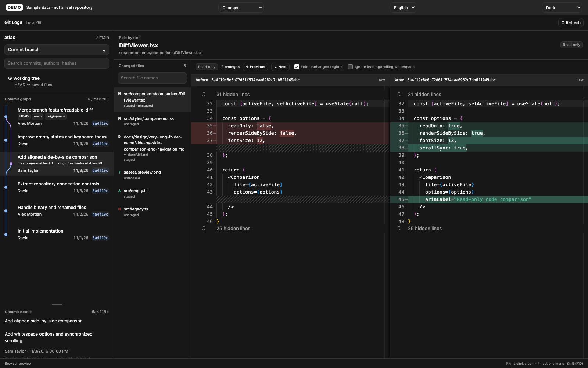

# Tienne Orca Plugins

[English](README.md) · 한국어

pnpm, Nx, TypeScript, React, Vite, esbuild를 사용하는 Orca 플러그인 저장소입니다. `plugins/` 아래의 각 폴더를 독립적인 플러그인으로 빌드하고 설치할 수 있습니다.

## 플러그인

| 플러그인                                          | 기능                                                  | 상태              |
| ------------------------------------------------- | ----------------------------------------------------- | ----------------- |
| [Git Logs](plugins/git-logs/README.ko.md)         | 커밋 그래프, 브랜치와 커밋 검색, 좌우 Diff, 커밋 작업 | 0.2.3             |
| [Orcatopia](plugins/orcatopia/README.ko.md) | 워크트리 탐험, 랜드마크 수집, 섬 배치와 세계지도      | 커뮤니티 카탈로그 |

소스 브랜치의 카탈로그는 빈 템플릿입니다. 설치용 카탈로그와 빌드 파일은 `release` 브랜치에서 관리합니다. Orca의 **설정 → 플러그인 → ⋯ → Catalog sources…**에 `https://github.com/tienne/orca-plugins.git`과 ref `release`를 추가한 뒤 Git Logs를 설치하십시오. [설치·사용 안내](plugins/git-logs/README.ko.md#설치)에 권한과 사용 방법을 설명합니다.

## Git Logs

Orca 안에서 Git 로그, 트리, 커밋 그래프를 탐색하는 도구입니다. 변경 파일을 중앙 탭에서 열어 내용을 좌우로 비교할 수 있습니다.

- 최근 최대 200개 커밋의 부모 관계, HEAD, 로컬 및 원격 브랜치를 표시합니다.
- 브랜치로 이력을 좁히고 커밋 메시지, 작성자, 해시를 검색할 수 있습니다.
- 줄과 단어 단위 강조, 동기 스크롤, 변경 이동, 변경 없는 영역 접기를 지원합니다.
- 커밋 우클릭 메뉴에서 체크아웃, 브랜치 생성, 병합, 리베이스, 체리픽, 리버트, 리셋을 실행할 수 있습니다.
- Orca 테마 색상과 한국어, 영어 UI를 지원합니다.

Diff는 읽기 전용입니다. Git 변경 작업은 별도 확인창을 거쳐 실행합니다. Orca가 관리하는 로컬 Git 작업 공간에 연결하며 SSH 작업 공간은 지원하지 않습니다. 비교 기준, 권한, 작업별 제한은 [Git Logs 사용 안내](plugins/git-logs/README.ko.md)를 참고하십시오.



샘플 데이터로 만든 브라우저 DEMO입니다. 실제 저장소나 Orca 호스트를 촬영한 화면은 아닙니다.

[라이트 테마](docs/screenshots/git-logs-light.png) · [커밋 메뉴](docs/screenshots/git-logs-commit-menu.png) · [스크린샷 안내](docs/screenshots/README.ko.md)

## 로컬에서 개발하기

Node.js 22.12 이상 또는 24 이상, pnpm 10, Git이 필요합니다. Orca 연결과 manifest 검증에는 Orca 데스크톱 앱과 CLI도 필요합니다. Git Logs의 최소 Orca 버전은 1.4.248입니다.

저장소 루트에서 실행하십시오.

```sh
pnpm install
pnpm nx run git-logs:build
pnpm nx run git-logs:preview
```

빌드 결과는 `dist/plugins/git-logs`에 생성됩니다. UI, Monaco, SVG 아이콘, editor worker, 두 언어의 사용 안내와 의존 라이선스를 포함합니다. 설치 후에는 별도 `node_modules` 폴더가 필요하지 않습니다.

브라우저에서 `http://127.0.0.1:4173`을 열어 보십시오. 영문 샘플 주소는 `http://127.0.0.1:4173/?lang=en&sample=en`입니다. DEMO는 Git 명령을 실행하지 않습니다. 소스를 수정하면서 확인하려면 `pnpm dev`를 사용하십시오.

Orca에서 사용하려면 접근 범위를 검토하고 [로컬 설치 절차](plugins/git-logs/README.ko.md#로컬에서-설치하기)를 따르십시오. Git Logs는 사용자 계정 권한으로 Node 프로세스를 실행하고 `workspace:read`, `workspace:write` 권한을 요청합니다.

## 빌드 검증하기

```sh
pnpm nx run-many -t build typecheck test ui-test -p git-logs
pnpm validate
```

| Target            | 확인 내용                                                                |
| ----------------- | ------------------------------------------------------------------------ |
| `test`            | 임시 저장소의 Git 작업, 번역 문구, 산출물 규칙                           |
| `ui-test`         | 패키징한 그래프, Diff, 테마, 언어, 키보드 조작, 레이아웃                 |
| `validate-plugin` | 빌드 산출물의 Orca manifest 검증. `pnpm validate`로 전체 플러그인에 실행 |
| `screenshots`     | 영문 DEMO의 라이트, 다크, 커밋 메뉴 화면 캡처와 소개 카드                |

브라우저 검증은 설치된 Google Chrome을 사용합니다. Chromium을 사용하려면 `pnpm exec playwright install chromium`을 실행한 뒤 `PW_CHANNEL=chromium`을 설정하십시오. 테스트 결과는 `test-results/`에 저장됩니다.

README 이미지를 다시 만들려면 실행하십시오.

```sh
pnpm nx run git-logs:screenshots
```

## 저장소 구조

```text
plugins/git-logs/         # 플러그인 소스, manifest, 사용 안내
  src/ui/                # 그래프, Monaco Diff, 브라우저 fixture
  src/worker/            # Git과 파일 접근, 작업 확인 및 실행
  showcase/              # 영문 스크린샷 캡처
scripts/                 # 빌드, 테스트, 산출물 검사
docs/development.ko.md   # 호스트 연결, 검증, 릴리스 참고
docs/screenshots/        # DEMO 이미지와 캡처 안내
dist/plugins/git-logs/   # 빌드 결과. Git에서 제외
orca-catalog.json        # 소스 카탈로그 템플릿 · 실제 릴리스는 release에서 관리
```

Git과 파일 작업은 worker에서 처리합니다. 플러그인 프레임에는 로컬 번들 에셋만 사용합니다. 소스 manifest는 패키징된 파일을 가리키므로 소스 폴더가 아닌 `dist/plugins/*`를 검증하십시오.

## CI와 배포

PR과 main push는 GitHub 호스팅 Ubuntu에서 빌드·타입·Git·브라우저·배포 테스트를 실행합니다. 수동 배포는 미리보기로 시작하며, 실제 공개에는 별도로 설정한 macOS Orca 러너와 production 환경을 사용합니다. 설정과 권한, main → release 흐름은 [Git 브랜치와 배포](docs/releases.ko.md)에 정리했습니다.

소스는 [tienne/orca-plugins](https://github.com/tienne/orca-plugins)에 공개돼 있습니다. 릴리스할 때는 빌드 결과물을 Git에 포함하고 카탈로그에서 설치할 폴더를 정확한 커밋과 `contentHash`로 고정해야 합니다. 배포 조건과 현재 검증 기록은 [개발 안내](docs/development.ko.md)에 정리했습니다.

## 라이선스

[MIT](LICENSE). 의존 라이선스는 각 플러그인 빌드의 `licenses/`에 포함됩니다.
