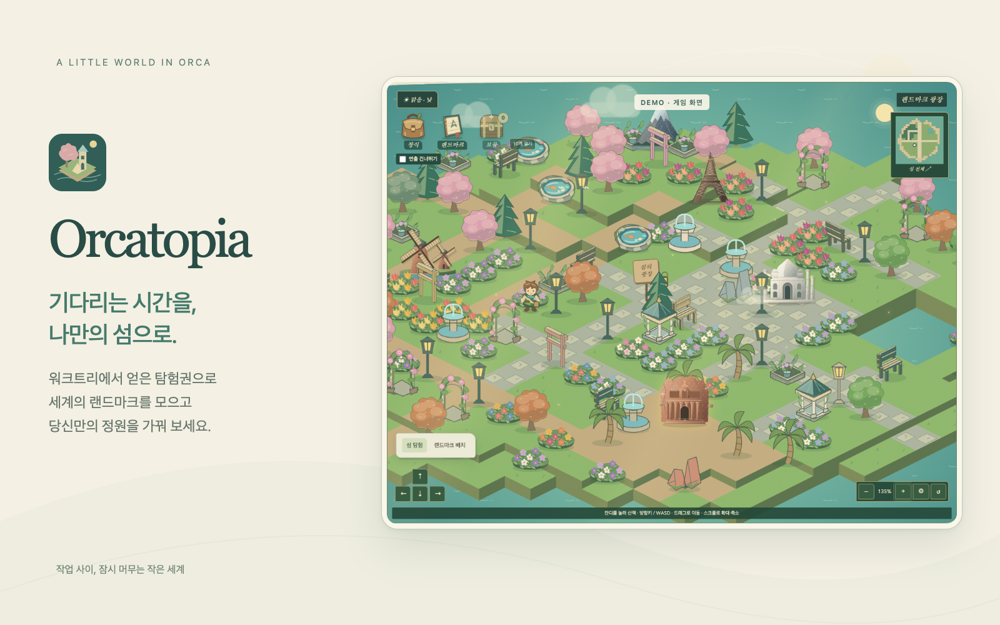

# Orcatopia

[English](README.md) · 한국어



Orcatopia는 Orca에서 작업을 기다리는 동안 잠시 머무는 나만의 섬입니다. 워크트리를 만들면 탐험권을 받고, 세계의 랜드마크를 발견해 섬을 꾸밀 수 있습니다. Orca 1.4.248 이상이 필요한 미출시 프로토타입입니다.

## 플레이

랜드마크 소개·백업·발견 모달이 열린 동안에는 모달 내부만 스크롤됩니다. 모달 끝이나 배경에서 휠을 움직여도 뒤의 페이지는 움직이지 않으며, 닫으면 기존 위치에서 페이지 스크롤이 다시 가능합니다.

Orcatopia 패널의 **Explore island**에서 땅을 누르면 건물을 피해 걸어갑니다. 섬 화면에 포커스를 두고 방향키/WASD를 누르거나 화면의 방향 버튼으로도 이동합니다. 카메라가 탐험가를 따라갑니다. 화면을 드래그하면 자유롭게 이동합니다. 맵 위에 커서를 올리고 스크롤하면 클릭·포커스·보조키 없이 커서 위치를 기준으로 12~180% 확대/축소합니다. 맵 밖에서는 페이지가 스크롤됩니다. 휠 확대/축소는 키보드 포커스를 가져오지 않고 자유 카메라로 전환합니다. 드래그·확대/축소·섬 전체 보기 후 캐릭터를 다시 움직이면 현재 배율을 유지하면서 자동 추적을 재개하고 캐릭터를 화면 중앙에 유지합니다. 이동할 수 없는 곳을 지정하면 카메라는 그대로 유지됩니다. **Follow explorer**로 이동 없이 캐릭터를 다시 중앙에 둘 수도 있습니다. + / − 버튼과 두 손가락 핀치도 사용할 수 있습니다. 미니맵의 **Whole island**로 섬 전체를 보고 **Follow explorer**로 캐릭터를 다시 따라갑니다. 초기화 버튼은 100% 배율과 추적을 복원합니다.

섬 캔버스에 가방 모양의 **Decorations** 메뉴와 책 모양의 **Landmarks** 메뉴와 남은 뽑기권 수가 표시된 **Treasure** 보물상자가 있습니다. 장식·랜드마크 목록은 처음에는 접혀 있으며 누르면 섬 아래가 아닌 캔버스 안에 목록이 열립니다. 목록 안에서 스크롤하면 지도 확대나 페이지 스크롤 없이 목록만 움직이고, 메뉴를 전환해도 각각의 스크롤 위치가 유지됩니다. ×, 같은 메뉴를 다시 누르거나 보관함 안에서 Escape로 닫습니다. 물건을 고르면 보관함이 닫히고 섬으로 포커스가 돌아와 배치할 수 있습니다. 제작할 때는 보관함이 유지됩니다. World Map에서도 섬 도감으로 이동할 수 있습니다. 열린 메뉴와 스크롤 위치는 현재 세션에서만 유지됩니다. 화면 크기에 맞춰 캔버스를 더 넓고 높게 표시하며, 장식 안내는 접어서 수집품에 공간을 우선 배정합니다.

목록 위의 검색창에서 현재 UI 언어와 관계없이 한글·영문 이름, 국가, 지역으로 찾을 수 있습니다. **보유 중**, **배치 가능**, 희귀도 필터 또는 **타일 / 식물 / 가구·시설 / 물 장식** 분류를 함께 사용합니다. 열린 세트 전체 상태에서 장식을 검색하면 모든 정원 세트로 전환되어 미해금 항목도 찾을 수 있으며, 배치·제작에는 기존 해금·수량 조건을 적용합니다. 검색 중에는 맵과 입력창을 다시 만들지 않습니다. 목록마다 검색어와 필터를 따로 기억하므로 닫았다 다시 열어도 유지됩니다. **검색어 지우기**는 글자만 지우고, **필터 초기화**는 해당 목록의 조건을 기본값으로 되돌립니다. 이 설정은 저장 데이터를 바꾸지 않으며 패널을 새로고침하면 초기화됩니다.

**Arrange landmarks**는 배치 모드입니다. 수집 카드를 선택해도 이 모드로 전환됩니다. 보유 랜드마크와 빈 칸을 선택해 배치합니다. 놓인 건물을 선택하면 동작 메뉴가 열립니다. **이동**을 누른 뒤 안내에 따라 목적지의 빈 칸을 클릭해야 이동합니다. 선택만 한 상태에서는 다른 칸을 눌러도 움직이지 않으며, **이동 취소**는 원래 위치를 유지합니다. **Return to collection**으로 배치를 해제합니다. 보유 수량만큼 배치할 수 있고 해제해도 소유권은 유지됩니다. **World Map**은 섬 배치와 무관하게 실제 위치와 국가별 고유 수집 수를 표시합니다. Refresh는 저장 데이터를 읽기만 합니다. UI는 Orca 언어 설정에 따라 한국어 또는 영어로 표시합니다.

모드 전환과 꾸미기 도구는 모두 섬 캔버스 안에 있습니다. **랜드마크 배치**를 누르거나 가방·도감에서 보유한 물건을 선택하면 캔버스 안에서 배치 안내, 물건·바닥 층 선택, 회전, 브러시, 취소, 회수와 배치 되돌리기를 사용할 수 있습니다. **꾸미기 완료**를 누르면 선택을 해제하고 산책으로 돌아갑니다. 편집은 각각 실행할 때 저장됩니다. 목록을 열면 꾸미기 패널을 잠시 숨겨 두 패널이 겹치지 않게 합니다.

97개 수집 국가의 100종(발견 56, 보물 32, 경이 9, 불가사의 3)을 제공합니다. 등급 확률은 70/23/6/1%이고, 등급 내에서는 균등 추첨합니다. 보유 아이템도 항상 추첨 대상이며 중복은 수량을 늘립니다. 뽑기권은 워크트리 생성으로만 받으며 구매, 천장, 완성 보장은 없습니다. 자체 제작 건축 벡터 일러스트를 로컬에 포함합니다. 랜드마크마다 석재 이음새와 풍화, 철골 격자, 대리석 돔, 구리 녹청, 지붕 타일 또는 산의 지층에 맞는 명암과 표면 디테일을 넣었습니다. 질감이 보이도록 수집 카드와 도감의 그림을 키웠습니다. 사진이나 실측 건축 모형이 아닌 질감 있는 일러스트입니다. 섬과 획득 연출에도 같은 그림을 사용하며 불가사의 애니메이션과 동작 줄이기를 유지합니다.

`workspace.created`의 `kind: worktree`만 뽑기권 한 장을 지급하며 랜드마크를 자동 추첨하지 않습니다. 폴더 생성, 대화, 새로고침, 작업공간 전환, 앱 시작은 지급하지 않습니다. 섬의 **보물** 상자를 누르면 캔버스 안에 보유 탐험권 수, **1개 열기**, **10개 열기**, **연출 건너뛰기**를 모은 메뉴가 열립니다. 메뉴를 여는 것만으로 탐험권을 쓰지 않으며 0장일 때도 열 수 있습니다. **1개 열기**는 탐험권 한 장을 사용하고 필요한 장수가 부족한 선택은 비활성화됩니다. ×, Escape, 상자 다시 누르기 또는 메뉴 밖 클릭으로 닫습니다. 장식·랜드마크 메뉴와는 하나씩 열립니다. 추첨 실패 시 메뉴가 다시 열리고 같은 탐험권으로 재시도합니다. 미사용 뽑기권은 누적되며 재시작이나 워크트리 삭제 후에도 유지됩니다.

보물 메뉴 안의 **10개 열기**를 누르면 탐험권 10장으로 한 번에 엽니다. 미사용 탐험권이 10장 이상일 때 사용할 수 있습니다. 10개 결과를 한 번에 저장한 뒤 보여주며, 실패하거나 응답이 유실되면 **10개 재시도**로 같은 탐험권의 결과를 복구합니다. 단일 뽑기와 확률·중복 보상은 동일하며 높은 등급을 보장하지 않습니다.

한 개·열 개 뽑기 모두 **등급과 관계없이 처음 발견한 랜드마크는 연출**합니다. 보물 메뉴 안의 **연출 건너뛰기** 체크박스를 켜면 한 개·10개 열기 모두 결과를 바로 보여주며, 끄면 새 발견 연출을 다시 재생합니다. 기본값은 꺼짐입니다. 패널을 열어 둔 동안 뽑기·새로고침 버튼·보관함 전환 후에도 유지되고, 패널을 다시 열면 초기화됩니다. 중복 획득은 결과를 바로 보여줍니다. 한 묶음에서 같은 새 랜드마크가 여러 번 나오면 첫 획득만 새 발견으로 분류합니다. 해당되는 연출을 차례로 보여주며 **10개 결과 모두 보기**나 Escape로 건너뛰고 전체 결과를 확인합니다. 전체 결과에는 모든 획득품의 새 발견·중복 여부, 국가, 등급, 선물·재료와 배치 버튼을 표시합니다. 닫거나 건너뛰어도 탐험권을 추가로 쓰지 않습니다. 동작 줄이기 설정에서는 연출을 기다리지 않습니다. 별도 미리보기에서는 네 등급의 연출을 모두 볼 수 있습니다.

열 개수를 고르면 메뉴를 닫고 캔버스를 화면에 맞춰 보여주며, 그 안에서 획득 결과를 표시합니다. 워커의 변경 알림은 결과를 닫은 뒤 캔버스를 새로고침하며, 연출 도중 받은 뽑기권도 그때 반영합니다. 화면 크기를 바꿔도 보이는 캔버스 경계 안에 유지하며 연출·결과의 스크롤은 지도 확대나 페이지 스크롤로 이어지지 않습니다. 결과를 닫을 때까지 배경 조작은 잠깁니다. 결과를 닫으면 보물상자로 키보드 포커스가 돌아갑니다. 별도 연출 미리보기는 독립 화면을 유지합니다. 봉인된 초대장이 열리면 종이 지도가 펼쳐지고 카메라가 다가가며 같은 옅은 빛이 꼬리를 남기고 이동합니다. 목적지 부근에서 등급을 예고합니다. 보물은 푸른빛으로, 경이는 보랏빛 고리와 갈라지는 안개로, 불가사의는 잠깐 느려진 뒤 크게 확장되는 금빛·무지갯빛 고리로 표현합니다. 한 번의 빛 전환 뒤 큰 랜드마크, 이름·등급, 조작 버튼 순서로 공개합니다. 발견/보물/경이/불가사의 연출은 각각 4/4.3/4.6/5.1초입니다. 결과의 불가사의 미니어처는 떠오르고 돌 조각이 공전합니다. 사용자가 제공한 [가챠 연출 레퍼런스](https://youtube.com/shorts/GlzSNKIY_LE)의 타이밍과 색상 신호를 참고했으며 그림과 효과는 자체 제작한 번들 SVG/CSS입니다. **Skip animation**이나 Escape로 저장된 결과를 즉시 보고, 동작 줄이기 설정에서는 기다림 없이 표시합니다. 결과에 국가·등급·보유 수량과 **Place on island**, **Keep exploring** 버튼을 표시합니다. 결과 화면에서는 Escape로 닫습니다.

워커 큐가 뽑기권 지급·사용·배치를 직렬화합니다. 워크트리 ID를 뽑기권 식별자로 사용하며, 결과와 사용 처리를 한 번에 저장한 뒤 연출합니다. 같은 뽑기권을 재요청해도 응답 유실·워커 재시작 전의 저장된 결과를 돌려줍니다. 실제 저장이 완료되지 않은 실패는 뽑기권을 소비하지 않으며, 저장 뒤 응답만 유실된 경우 재시도로 결과를 복구합니다. 연출 중 새로고침해도 수집품은 남습니다. 애니메이션은 추첨 결과를 결정하지 않습니다. 이벤트 경로에 접근하거나 Git을 실행하지 않습니다.

신규 획득에는 금빛 별 배지와 **새로운 발견 · 섬에 배치**를, 중복 획득에는 체크 배지와 **이미 발견한 랜드마크 · 하나 더 배치**를 표시합니다. 둘 다 배치할 수 있으며 중복은 추가 보유분과 재료 3개를 줍니다. 10개 결과에서는 각 획득 시점의 보유 수량도 표시하고, 같은 신규 랜드마크가 여러 번 나오면 첫 번째만 새 발견으로 표시합니다.

한 개 뽑기 결과와 10개 전체 결과에서 **1개 더 뽑기**, **10개 더 뽑기**로 바로 이어서 뽑을 수 있습니다. 남은 뽑기권을 표시하며 각각 1장·10장 미만이면 버튼을 비활성화합니다. 연출 건너뛰기 설정을 유지하고 기존의 저장·재시도 흐름을 사용합니다. 10개 뽑기의 개별 신규 연출에서는 전체 결과로 이동한 뒤 추가 뽑기를 선택합니다. 별도 연출 미리보기에는 추가 뽑기 버튼이 없습니다.

v1/v2/v3/v4 저장을 검증한 뒤 v5로 읽습니다. 랜드마크 방향의 기본값은 원래 그림입니다. 기존 풀·길 장식은 같은 칸의 별도 바닥 층으로 옮기며 나머지 물건은 위치와 원래 방향을 유지합니다. v1 영수증은 이미 사용한 뽑기권으로 처리해 보유 수량과 워크트리 중복 방지를 유지하고 추가 뽑기권을 지급하지 않습니다. 기존 랜드마크 배치의 셀 ID를 유지하고 그 배치를 포함할 만큼 땅을 열어 둡니다. 첫 발견 선물과 중복 재료는 기존 전체 획득 기록에서 계산하므로 예전 수집품에도 적용되며, 별도 수령이나 반복 지급은 없습니다. 다음 변경 저장부터 기존 키(`island-v1`, 데모는 `landmark-island-demo-v1`)에 v5를 기록합니다. 읽기만으로 저장을 덮어쓰지 않으며 이전 빌드는 v5 저장을 읽을 수 없습니다.

총 208종의 장식에는 정원의 중심을 꾸미는 네 종류가 포함됩니다. **달빛 잉어 연못**(후지산, 재료 9개), **대리석 정원 파빌리온**(타지마할, 12개), **장미 덩굴 아치**(에펠탑, 9개), **양치식물 화단**(앙코르 와트, 6개)입니다. 해당 랜드마크를 보유하면 작업실 테마가 해금되며 중복 획득 재료로 제작합니다. 각각 한 칸을 차지하고 산책을 막으며 이동·회수가 가능합니다. 방향은 고정이고 직접 제작한 정적 벡터 그림을 사용합니다. 제작·배치 기록은 파일 백업에 포함됩니다. 이 장식이 추가되기 전 빌드에서는 새 장식이 포함된 백업을 복원할 수 없습니다.

배치를 편집할 때 섬·카메라·배경 애니메이션 요소를 유지하고 바뀐 바닥과 기물만 갱신합니다. 변경되지 않은 랜드마크의 애니메이션은 계속 이어집니다. 장애물 때문에 탐험가가 다른 빈 칸으로 옮겨져도 편집 중에는 현재 카메라 구도를 유지하며, 산책으로 돌아가면 캐릭터 추적을 재개합니다. 저장이나 메뉴 변경으로 자동 날씨 전환 타이머를 다시 시작하지 않습니다.

## 언어

플러그인은 Orca의 공개 설정인 `orca.locale`을 따릅니다. 한국어와 영어를 지원하며, 설정이 없거나 잘못되었거나 다른 언어이면 영어로 표시합니다. 설치된 호스트 API에 언어 변경 이벤트가 문서화되어 있지 않아 500ms마다, 그리고 프레임이 포커스나 가시성을 되찾을 때 변경 여부를 확인합니다.

언어를 바꿀 때 화면의 텍스트를 제자리에서 갱신하여 카메라 위치, 선택, 열린 대화상자, 백업 확인 및 진행 중인 뽑기 연출 타이머를 유지합니다. Orca 자체에서 프레임을 새로 불러올 수는 있습니다. 메뉴, 접근성 이름, 날씨, 희귀도, 수량, 장식 이름, 랜드마크 설명과 출처, 세계 지도 국가명, 알려진 오류 및 백업 날짜를 번역합니다. 브랜드명, URL, 파일명, 알 수 없는 호스트 오류의 상세 내용은 그대로 표시합니다. 운영체제의 파일 선택 대화상자는 시스템 언어를 따릅니다.

번역은 `src/messages.ko.json`과 `src/landmarks.ko.json`에 있습니다. 저장 식별자, 지급 기록, 뽑기 확률과 저장 형식은 바뀌지 않습니다. 독립 브라우저 미리보기는 브라우저 언어를 따르며 `?lang=ko` 또는 `?lang=en`으로 지정할 수 있습니다. 연출 전용 미리보기는 `?preview=reveal&lang=ko`를 사용할 수 있습니다. 실제 호스트 프레임에서는 이 미리보기 옵션 대신 항상 Orca 언어를 따릅니다.

## 희귀도와 수집 진행률

각 랜드마크의 등급은 고정되어 있습니다. **I Discovery** 발견(56종, 등급 추첨 확률 70%), **II Treasure** 보물(32종, 23%), **III Marvel** 경이(9종, 6%), **IV Wonder** 불가사의(3종, 1%)입니다. 배지에는 로마 숫자와 네 칸 척도를 함께 표시합니다. 한 칸이 가장 낮고 네 칸이 가장 높은 희귀도이며 카드·필터·상세 도감·획득 알림에서 같은 표시를 사용합니다. 스크린리더에는 “Wonder, rarity 4 of 4”처럼 읽어 줍니다. 색상은 보조 표현이며 미보유 항목도 등급 척도를 온전히 표시합니다. 강화 진행률이 아닌 고정 등급입니다. 최근 획득 알림과 상세 도감에 등급을 표시하며, 도감에서는 등급 추첨 확률도 설명합니다. 개별 아이템 확률이 아닌 등급 확률이며 등급 안에서는 균등 추첨합니다.

도감에 전체/등급별 필터와 진행률 막대가 있습니다. 고유 종류 수를 세므로 중복 획득은 보유 수량만 늘리고 완성도를 올리지 않습니다. 필터는 보이는 수집 목록만 바꾸며 섬 모드·카메라·배치·추첨 확률에 영향을 주지 않습니다. 미보유 랜드마크도 등급과 소개를 볼 수 있습니다. 내부 ID는 `common`, `rare`, `epic`, `legendary`를 유지합니다. 2026-11-07 배정으로 등급은 바뀌며 등급 추첨 확률과 저장 수량은 유지합니다. 천장이나 완성 보장은 추가하지 않았습니다.

획득한 보물에는 푸른 광택, 경이에는 보랏빛 후광을 표시합니다. 불가사의인 페트라와 앙코르 와트, 마추픽추는 금빛 테두리와 살아 움직이는 미니어처를 갖습니다. 그림자는 지면에 남고 본체가 떠오르며 돌 조각과 빛이 주위를 공전합니다. 도감·상세 설명·섬 배치에서 같은 연출을 사용하고 미획득 상태는 움직이지 않습니다. 동작 줄이기 설정에서는 떠 있는 자세와 빛을 정적으로 표시합니다. 가상의 시각 연출이며 이동·배치·보유 수량·추첨 확률은 바꾸지 않습니다.

## 등급 배정 변경 (2026-11-07)

도감의 등급별 종류 수를 발견 18·보물 10·경이 5·불가사의 3종으로 조정했습니다. 게임의 편집 배정이며 내부 점수와 선정 기준은 화면에 표시하지 않습니다. 등급 확률은 70/23/6/1%를 유지합니다. 새 항목을 추가할 때 기존 도감의 등급을 자동으로 재정렬하지 않습니다.

기존 보유품도 새 배지와 효과로 표시하며 백업 복원 시에도 같습니다. ID·수량·획득 기록·배치·장식 선물·제작 재료·열린 땅을 보존하며 재추첨이나 보상 추가 지급은 없습니다. 페트라·앙코르 와트·마추픽추에 불가사의 움직임을 적용하고, 기자 대피라미드와 만리장성은 경이 효과, 킬리만자로는 발견 표현을 사용합니다. 새 불가사의 모두 동작 줄이기를 지원합니다. 아래 표와 확장 목록의 등급은 현재 배정입니다.

| 등급        | 랜드마크                                                                                                                                                                                                                                           |
| ----------- | -------------------------------------------------------------------------------------------------------------------------------------------------------------------------------------------------------------------------------------------------- |
| I 발견      | 자유의 여신상, 후지산, 경복궁, 머라이언, 브란덴부르크 문, 벨렝 탑, 구세주 그리스도상, 그레이트 짐바브웨, CN 타워, 킨더데이크 풍차, 할그림스키르캬, 아토미움, 페트로나스 트윈 타워, 쉐다곤 파고다, 아이트벤하두, 시기리야, 소서스블레이, 킬리만자로 |
| II 보물     | 에펠탑, 스톤헨지, 시드니 오페라 하우스, 치첸이트사, 부르즈 할리파, 아야 소피아, 보로부두르 사원, 라파누이 모아이, 아테네 아크로폴리스, 성 바실리 대성당                                                                                            |
| III 경이    | 콜로세움, 타지마할, 기자 대피라미드, 사그라다 파밀리아, 만리장성                                                                                                                                                                                   |
| IV 불가사의 | 페트라, 앙코르 와트, 마추픽추                                                                                                                                                                                                                      |

## 랜드마크 도감

수집 목록에 국가를 등급과 별도로 표시합니다. **About this landmark**를 누르면 국가·지역·짧은 역사 소개·공식 출처 링크가 있는 도감이 열립니다. 아직 획득하지 않았거나 배치할 여분이 없어도 100종 모두 읽을 수 있습니다. 탐험·배치 모드 모두 놓인 건물을 누르면 기물 메뉴가 열리며, **랜드마크 소개**를 선택해 설명을 읽습니다. 읽기는 보상이나 배치 상태를 바꾸지 않습니다. × 버튼이나 Escape로 닫으면 원래 조작 위치로 키보드 포커스를 돌려줍니다.

설명은 2026-11-05에 UNESCO, 에펠탑 운영기관, 로마 관광청, APSARA, 이집트 관광유물부 자료로 확인해 직접 작성한 영어 요약입니다. 소개 출처는 기존 Wikidata 좌표 출처와 별도로 저장합니다. 본문은 번들에 포함되어 오프라인에서도 읽습니다. 플러그인 프레임에서 출처를 클릭하면 공식 `orca.shell.openExternal` API를 호출해 Orca가 열기와 동의를 처리하며, 로드 시 자동으로 외부 링크를 열지 않습니다. 브라우저 데모는 일반 링크를 사용합니다. 호스트에서 열기에 실패하면 도감 안에 안내합니다.

## 확장된 수집품

2026-11-06 첫 확장으로 아래 12종을 추가해 총 24종이 되었습니다. 희귀도는 게임의 수집 등급이며 공식 유산 분류나 문화적 가치의 우열을 뜻하지 않습니다.

| 랜드마크          | 국가         | 희귀도   |
| ----------------- | ------------ | -------- |
| 경복궁            | 대한민국     | I 발견   |
| 머라이언          | 싱가포르     | I 발견   |
| 브란덴부르크 문   | 독일         | I 발견   |
| 벨렝 탑           | 포르투갈     | I 발견   |
| 구세주 그리스도상 | 브라질       | I 발견   |
| 부르즈 할리파     | 아랍에미리트 | II 보물  |
| 아야 소피아       | 튀르키예     | II 보물  |
| 보로부두르 사원   | 인도네시아   | II 보물  |
| 그레이트 짐바브웨 | 짐바브웨     | I 발견   |
| 사그라다 파밀리아 | 스페인       | III 경이 |
| 라파누이 모아이   | 칠레         | II 보물  |
| 만리장성          | 중국         | III 경이 |

두 번째 확장으로 다음 12종을 더해 총 36종이 되었습니다.

| 랜드마크             | 국가       | 등급    |
| -------------------- | ---------- | ------- |
| CN 타워              | 캐나다     | I 발견  |
| 킨더데이크 풍차      | 네덜란드   | I 발견  |
| 할그림스키르캬       | 아이슬란드 | I 발견  |
| 아토미움             | 벨기에     | I 발견  |
| 페트로나스 트윈 타워 | 말레이시아 | I 발견  |
| 쉐다곤 파고다        | 미얀마     | I 발견  |
| 아테네 아크로폴리스  | 그리스     | II 보물 |
| 성 바실리 대성당     | 러시아     | II 보물 |
| 아이트벤하두         | 모로코     | I 발견  |
| 시기리야             | 스리랑카   | I 발견  |
| 소서스블레이         | 나미비아   | I 발견  |
| 킬리만자로           | 탄자니아   | I 발견  |

등급 확률은 70/23/6/1%를 유지하며 현재 등급별 종류 수는 56/32/9/3종입니다. 개별 랜드마크 확률은 각각 약 1.25% / 0.71875% / 0.6667% / 0.3333%입니다. 기존 획득 기록, 배치 주소, 선물과 열린 땅은 유지하고 새 항목은 일반 탐험권 추첨에 포함합니다. 읽기만으로 새 랜드마크를 지급하지 않습니다. 수집 진행률의 분모가 100으로 바뀌므로 수집품 손실 없이 표시 퍼센트가 낮아질 수 있습니다. 새 랜드마크나 장식 ID가 들어 있는 백업은 해당 ID를 포함한 빌드에서 읽어야 하며 그 이전 도감 빌드에서는 읽을 수 없습니다. 저장 스키마와 키는 동일합니다.

새 항목마다 질감 있는 전용 SVG, 한국어·영어 설명, 공식 출처 링크, 지도 위치와 장식 두 종류를 포함합니다. 설명은 연결된 공식 유산·관광·기념물 기관 자료를 확인해 직접 작성했습니다. 라파누이·만리장성·풍차군과 자연 경관의 지도 점은 대표 위치이며 정확한 경계가 아닙니다. 쉐다곤의 출처는 미얀마가 제출한 유네스코 잠정목록 자료이며 세계유산 등재를 뜻하지 않습니다. 불가사의 효과는 현재 도감 등급에 따라 표시합니다. 킬리만자로는 발견 등급으로 바뀌어 기본 그림을 정적으로 표시합니다. 외부 이미지·폰트·실행 중 네트워크 요청은 추가하지 않았습니다.

땅은 처음 12종까지 기존과 동일하게 318칸을 엽니다. 13~100번째 서로 다른 발견은 외곽 정원을 계속 넓혀 최대 1,044칸까지 열립니다. 장식은 테마 200종, 무료 기본 4종과 정원 중심 장식 4종으로 총 208종입니다.

## 세 번째 도감 확장 (2026-11-08)

새 명소 12종을 더해 총 48종을 수집할 수 있습니다. 기존 랜드마크의 등급과 등급 추첨 확률은 유지하며, 전체 분포는 발견 24·보물 14·경이 7·불가사의 3종입니다. 새 항목은 일반 탐험권 추첨에 포함되며 기존 저장에 무료 보상을 추가하지 않습니다.

| 랜드마크                    | 수집 국가      | 등급     |
| --------------------------- | -------------- | -------- |
| 프라하 천문시계             | 체코           | I 발견   |
| 헝가리 국회의사당           | 헝가리         | II 보물  |
| 쇤브룬 궁전                 | 오스트리아     | I 발견   |
| 마터호른                    | 스위스         | II 보물  |
| 인어공주상                  | 덴마크         | I 발견   |
| 보르군 목조교회             | 노르웨이       | I 발견   |
| 헬싱키 대성당               | 핀란드         | I 발견   |
| 부에노스아이레스 오벨리스크 | 아르헨티나     | I 발견   |
| 두브로브니크 성벽           | 크로아티아     | II 보물  |
| 보드나트 스투파             | 네팔           | II 보물  |
| 하롱베이                    | 베트남         | III 경이 |
| 헤그라                      | 사우디아라비아 | III 경이 |

각 항목에 직접 그린 질감 있는 SVG, 한국어·영어 설명, 출처 링크, 지도 위치와 정원 장식 두 종류를 포함합니다. 국가 표시는 수집용 분류입니다. 마터호른은 스위스로 분류하고 설명에는 이탈리아와의 국경도 명시합니다. 넓은 경관의 지도 점은 대표 위치입니다. 당시 확장에서는 기존 육지 상한 318칸과 저장 형식을 유지했습니다. 새 ID가 포함된 백업은 이 도감 또는 이후 호환 빌드가 필요합니다.

## 현대 건축 랜드마크 확장 (2026-11-08)

현대 랜드마크 세 종류를 더해 48개국의 51종을 제공합니다. 롯데월드타워(한국)는 발견, 마리나 베이 샌즈(싱가포르)와 빌바오 구겐하임 미술관(스페인)은 보물 등급입니다. 유리 외벽, 정원이 있는 옥상 데크와 곡선 티타늄 표면을 섬의 동화풍 색감으로 직접 그렸습니다. 각각 한국어·영어 설명, 공식 출처, 지도 좌표와 정원 장식 두 종류를 포함합니다.

같은 나라의 기존 명소와 함께 수집할 수 있습니다. 두 명소를 모두 보유하면 해당 국가의 수집 수가 2/2가 되지만 고유 국가 수는 한 번만 셉니다. 서로 다른 랜드마크는 각각 첫 장식을 선물하고 땅 확장에 기여합니다. 같은 랜드마크의 중복은 기존 재료 보상을 유지합니다. 이전 획득·배치·등급은 그대로이며, 새 항목은 일반 뽑기권 추첨에 포함하고 자동 지급하지 않습니다. 새 ID가 담긴 백업은 이 도감 또는 이후 호환 빌드가 필요합니다.

## 새로운 8개국의 현대 랜드마크 (2026-11-08)

이전 확장에서는 도감이 56개국의 59종으로 늘었습니다. 카타르 국립박물관(카타르), 헤이다르 알리예프 센터(아제르바이잔), 바이테레크 타워(카자흐스탄), 방글라데시 국회의사당(방글라데시), 키갈리 컨벤션 센터(르완다), 블랙 스타 게이트(가나), 바이오무세오(파나마), 카사푸에블로(우루과이)를 추가합니다. 여덟 나라 모두 기존 도감에 없던 국가입니다. 여기서 현대는 최근 초고층 빌딩만이 아니라 여러 해에 걸쳐 지은 카사푸에블로 등 20~21세기 건축도 포함합니다.

카타르 국립박물관·헤이다르 알리예프 센터·방글라데시 국회의사당은 보물, 나머지 다섯 곳은 발견입니다. 공식 유산 등급이 아닌 게임의 편집상 수집 등급이며 이전 항목과 등급은 유지합니다. 각 항목에 직접 그린 벡터 그림, 한국어·영어 설명, 공식 기관 출처, 위키데이터 지도 좌표와 장식 두 종류를 연결합니다. 블랙 스타 게이트는 아크라의 인근 독립문과 구분합니다. 새 항목은 일반 뽑기에 포함되며 기존 수집 기록에 자동 지급하지 않습니다. 당시 확장에서는 저장 형식·기존 육지 318칸 상한·등급 확률을 유지했습니다. 새 ID를 포함한 백업은 이 도감 또는 이후 호환 빌드에서 읽어야 합니다.

## 추가된 여덟 여행지

이번에는 **타이베이 101**(대만), **레기스탄 광장**(우즈베키스탄), **술탄 카부스 그랜드 모스크**(오만)를 보물 등급으로 추가했습니다. **쿠웨이트 타워**(쿠웨이트), **바레인 세계무역센터**(바레인), **스카이 타워**(뉴질랜드), **티라나 피라미드**(알바니아), **루마니아 의회궁**(루마니아)은 발견 등급입니다. 수집 국가 여덟 곳이 새로 들어가 총 64개국·67종이 되었습니다. 각 설명의 출처는 도감에서 확인할 수 있습니다.

각 항목에 질감을 살린 자체 그림, 한영 설명, 지도 위치와 정원 장식 두 종류를 제공합니다. 한 개·10개 뽑기의 일반 추첨 대상에 포함되며 보상을 자동 지급하지 않습니다. 당시 확장에서는 기존 수집품·배치, 기존 육지 최대 318칸과 등급 확률을 유지했습니다. 새 항목이 포함된 백업은 이 도감 또는 이후 호환 빌드에서 복원해야 합니다.

## 랜드마크 100종과 넓어진 정원

랄리벨라, 젠네, 릴라 수도원, 파로 탁상, 왓 아룬, 티칼, 난마돌 등 33개 새 수집 국가의 실제 명소 33종을 추가했습니다. 전체 **97개국·100종**, **발견 56 / 보물 32 / 경이 9 / 불가사의 3종**이며 기존 항목의 등급은 유지합니다. 공식 유산 등급이 아닌 게임 수집 등급입니다. 각 항목에 한영 설명, 공식 기관 출처, 확인한 지도 위치, 질감 있는 자체 벡터 그림과 정원 장식 두 종류를 제공합니다. 각 항목의 도감에서 출처를 확인할 수 있습니다.

섬의 주소 격자는 40 × 40이며, 물을 제외한 실제 육지는 최대 **1,044칸**입니다. 기존 주소 576개와 기존 육지 318칸의 ID·지형·해금 단계를 보존하고 새 주소를 뒤에 추가해 배치가 그대로 남습니다. 기존 저장에 서로 다른 랜드마크가 12종 넘게 있으면 열 때 해당 수집 단계만큼 외곽 정원이 열립니다. 로드만으로 랜드마크·뽑기권·제작 보상을 지급하지 않습니다. 현재 저장 스키마는 랜드마크 방향을 포함한 버전 5입니다. 새 ID나 외곽 주소가 포함된 백업은 이 빌드 또는 이후 호환 빌드가 필요합니다.

## 장식 작업실과 섬 확장

꽃 장식은 작은 꽃과 잎이 모인 낮은 화단입니다. 튤립·초원·해안·열대 테마마다 꽃 색이 다르며 튤립에는 잔 모양 꽃잎을 사용합니다. 정원 나무는 겹친 잎의 명암으로 표현하고, 둥근 수관 외에 가느다란 로마 사이프러스와 층을 이룬 궁궐·산 소나무 실루엣도 제공합니다. 지형 단면은 노출된 해안과 높이가 달라지는 경계에만 그립니다. 모두 번들에 포함된 벡터 그림입니다.

새 섬은 중앙 36칸에서 시작합니다. **서로 다른 보유 랜드마크 종류**가 늘면 연결된 해안 구역이 열립니다. 고유 종류 0/1/2/4/8/12종에 육지는 36/59/83/130/224/318칸입니다. 중복, 뽑기권 획득, 배치·회수로는 확장되지 않습니다. 섬 제목 아래에 현재 넓이와 다음 수집 기준을 표시하며 미니맵과 전체 보기도 열린 영역에 맞춥니다. 잠긴 땅은 걷거나 배치할 수 없고 워커에서도 검사합니다. 현재 배치 수가 아닌 보유 종류 수가 기준이며 확장 구매는 없습니다. 처음 12종까지의 진행은 그대로 유지하고 13~100종은 연결된 외곽 정원을 엽니다. 25/50/75/100종에 425/631/837/1,044칸으로, 최대 넓이는 이전의 약 3.3배입니다.

캔버스의 가방 **Decorations** 메뉴로 여는 장식 작업실에서 **Soft grass**, **Earth path**, **Stone paving**, **Garden oak**를 무료로 무제한 배치할 수 있습니다. 랜드마크 100종마다 테마 장식 2종, 총 200종이 열립니다. 첫 번째 장식은 최초 발견 시 1개를 선물하고 추가 제작에 재료 3개, 두 번째 장식 제작에 재료 6개가 필요합니다. 중복 랜드마크는 소유권을 유지하면서 재료 3개를 줍니다. 에펠탑은 파리풍 등불과 카페 벤치, 기자 피라미드는 오아시스 야자수와 분수를 엽니다. 역사적 복원이 아닌 가상의 정원 해석입니다. Garden set 메뉴에서 미해금 세트도 미리 볼 수 있으며 기본은 열린 세트 전체입니다.

**Craft**로 표시된 장식을 확정 제작하고, **Place**와 열린 빈 칸을 눌러 배치합니다. Arrange landmarks 모드에서 놓인 장식을 선택하면 이동하거나 **Return to collection**으로 회수할 수 있습니다. 이동·회수는 무료이며 회수한 장식은 보관함에 남고 재료는 환급하지 않습니다. 풀·길·꽃은 걸어갈 수 있고 다른 장식은 이동을 막습니다. 고정 식물이 있던 칸에 장식을 놓으면 그림과 충돌을 대체하며 회수하면 원래 식물이 돌아옵니다. 한 칸에는 바닥 하나와 그 위에 랜드마크 또는 장식 하나를 함께 놓습니다. 재료로 뽑기권이나 랜드마크를 살 수 없으며 대기 시간·일일 과제·업로드·결제는 없습니다.

워커가 제작 요청을 직렬화하고 요청 ID를 저장합니다. 저장 후 응답 유실이나 재시작에도 **Retry craft**로 같은 결과를 복구하며 재료를 다시 차감하지 않습니다. 보유 장식과 재료는 획득·제작 기록에서 계산합니다. 백업에는 기존 컬렉션과 함께 제작 기록, 장식 배치, 보존된 땅 경계가 포함됩니다.

기존 셀 ID 0–35는 동일한 ID와 상대적인 6 × 6 배치를 유지하며 중앙(열/행 9–14)에 놓입니다. 주변 셀 ID도 확장 중 변하지 않습니다. 예전 저장의 외곽 배치는 필요한 확장 단계를 열어 보존합니다. 그 단계가 보유 종류 수보다 높으면 수집이 해당 단계를 넘었을 때부터 확장이 재개됩니다. 기존 배치를 옮기거나 회수해도 보존된 영역은 줄지 않으며 배치를 이동·삭제하지 않습니다. 산책 위치와 카메라는 세션 동안만 유지합니다.

## 기물을 선택한 뒤 이동

탐험·배치 모드에서 놓인 랜드마크나 장식을 누르면 해당 기물 옆에 메뉴가 나타나고 선택이 강조됩니다. **이동**을 눌러야 그 기물을 선택한 상태로 배치 모드에 들어가며, 열린 빈 칸을 누르면 이동이 완료됩니다. 이미 사용 중인 칸을 누르면 선택을 유지하고 다른 칸을 안내합니다. 이동이 끝나면 선택 전 모드로 돌아갑니다. Escape나 **이동 취소**는 원래 자리에 그대로 두고 선택 메뉴로 돌아가며, 선택 닫기는 저장을 바꾸지 않습니다. 메뉴는 카메라 변화에 맞춰 기물을 따라가고 캔버스 안에 유지됩니다. 바닥 층에서도 같은 선택 메뉴를 사용합니다. 회전·이동·되돌리기는 수집품과 아래 바닥을 유지합니다.

## 겹쳐 배치·브러시·되돌리기

**Arrange landmarks**에서 드러난 바닥 타일은 바로 눌러 선택합니다. 물건 아래의 타일은 물건을 선택한 뒤 **아래 바닥 선택**으로 고릅니다. **Floor**로도 바닥 층을 선택할 수 있습니다. **이동**을 누른 뒤 바닥이 없는 목적지를 클릭해야 타일이 이동하며, 선택만 해서는 움직이지 않습니다. 목적지 위에 물건이 있어도 바닥이 비어 있으면 이동할 수 있습니다. 취소·회수·되돌리기는 바닥에만 적용하며, **Objects**는 그 위 랜드마크나 장식을 선택합니다. 작업실에서 바닥을 고르면 자동으로 바닥 층으로 전환됩니다. 풀·흙길·돌바닥은 칸 전체를 덮고 고정 식물을 대체하며, 이미 놓인 물건 아래에도 칠할 수 있습니다. 물건을 옮기거나 회수해도 바닥은 남고, 바닥을 바꾸거나 지워도 위의 물건은 유지됩니다.

풀·길·꽃을 고르고 **Brush · On**을 켭니다. 섬 위를 드래그하면 연속 배치할 칸을 미리 표시하고 손을 놓으면 한 번에 저장합니다. 이미 같은 바닥인 칸은 건너뛰며 꽃은 물건이 있는 칸을 건너뛰고 보유 여유 수량에 도달하면 멈춥니다. 브러시는 자동 제작이나 재료 소비를 하지 않습니다. Escape, 포인터 취소, 포커스 이탈, 페이지를 벗어나는 동작은 미완료 획을 취소합니다. 브러시 선택 중에는 Alt+드래그로 지도를 이동하며, 브러시를 끄면 기존 드래그 이동으로 돌아갑니다. 획을 긋는 중이 아닐 때는 휠 확대·축소를 사용할 수 있습니다. 브러시를 끈 상태의 클릭은 한 칸씩 배치하며 **Cancel selection**으로 배치 선택을 취소합니다.

벤치와 정원 문은 배치 전 또는 Objects 층에서 놓인 물건을 선택한 뒤 **왼쪽 회전**·**오른쪽 회전**으로 90도씩 네 방향을 앞뒤로 돌립니다. 세워진 형태를 유지하는 벡터 도형을 방향마다 다시 그립니다. 랜드마크는 자체 그림의 좌우 반전으로 두 방향을 지원합니다. 왼쪽·오른쪽 회전 모두 두 방향 사이를 전환하며 3D 시점 회전은 아닙니다. 나머지 장식은 방향 고정 안내와 비활성 회전 버튼을 표시합니다. 이동 중 이미 사용 중인 목적지를 누르면 선택한 기물을 유지하고 다른 칸을 선택하라고 안내합니다. 방향은 이동·재로드·파일 백업에도 남습니다.

**Undo layout**은 현재 패널 세션의 최근 배치 변경을 최대 20회 되돌립니다. 배치·이동·회수·회전과 브러시 한 획 전체가 각각 한 번의 변경입니다. 바닥과 물건 배치만 되돌리며 뽑기권·발견·땅 확장·제작 보유 수량·재료는 유지합니다. 패널을 닫거나 새로고침하면 되돌리기 기록은 지워지고 최종 배치는 저장됩니다. 백업 복원이나 다른 패널의 배치 변경을 받으면 기록을 비웁니다. 워커가 현재 배치와 소유 수량을 다시 검사하므로 오래된 되돌리기로 다른 배치를 덮어쓸 수 없습니다. 이번 변경에는 다시 실행, 지형 조각, 연못 생성, 랜드마크 자유 회전은 포함하지 않습니다.

## 살아 있는 섬

종이 질감의 여행 일지를 유지하면서 짙은 숲빛, 초록 튜닉과 배낭을 멘 탐험가, 이끼 낀 바위와 돌길로 모험 분위기를 표현합니다. 언덕의 바위 장애물은 오래된 문양 비석으로 보이며 충돌과 배치 규칙은 같습니다. 햇살, 떠다니는 빛 입자와 길가 등불은 날씨·시간대 및 동작 줄이기 설정에 맞춰 연출됩니다. 장식 요소이며 퀘스트나 수집 보상은 아닙니다. 수집 목록은 도감처럼 배치했습니다. 그림과 질감은 번들 벡터/CSS이며 실행 중 폰트나 이미지를 다운로드하지 않습니다. 패널 배경·본문·버튼·선택 상태·키보드 포커스·입력 테두리·대화상자 조작부는 공식 `--orca-*` 테마 변수와 짝을 이루는 글자색 및 모서리 반경을 사용합니다. 테마 변경은 카메라나 수집 상태를 초기화하지 않고 즉시 반영됩니다. 호스트 변수가 없는 브라우저 데모는 종이색/어두운 독서용 기본 색상을 유지합니다. 섬 지형·랜드마크 그림·등급 효과는 게임 고유 색상이며 뽑기 무대는 테마가 적용된 대화상자 안의 아트워크입니다. 루트 rem 기준은 16px입니다.

고정된 아이소메트릭 지형에 중앙 광장, 숲, 초원, 석호, 계단식 언덕이 있습니다. 땅의 옆면을 그리고 캐릭터·나무·건물을 깊이 순서로 배치해 앞뒤 가림을 표현합니다. 꽃, 모래 해안, 움직이는 구름과 배도 있습니다. 로컬 벡터 기반 2.5D 장면이며 3D 물리 엔진은 아닙니다. **Weather**에서 맑음·흐림·비·눈을 고를 수 있습니다. **자동** 날씨는 패널이 보일 때 30초마다 바뀝니다. **시간대**의 기본값은 **자동 · 기기 시간**으로, 기기의 현지 시간대를 따라 새벽 05:00–07:00, 낮 07:00–17:00, 노을 17:00–19:00, 밤 19:00–05:00를 표시합니다. 조명·해와 달·별·정원 등불도 함께 바뀝니다. 실제 일출·일몰을 계산하는 기능은 아니며 고정된 연출 시간표입니다. 다음 전환 시각에 맞춰 갱신하고, 잠자기에서 돌아오거나 패널에 다시 포커스를 두거나 섬을 다시 열면 기기 시간을 확인합니다. 수동 시간대를 고르면 그 분위기를 유지하며 자동으로 돌아가면 즉시 현재 시간에 맞춥니다. 날씨와 시간대는 독립적이며 보상과 수집 기록을 바꾸지 않습니다. 수동 선택은 패널 세션 동안 유지되고 재로드하면 기기 시간으로 돌아갑니다. 낮·밤에는 위치 권한을 사용하지 않습니다. 별도의 타임존 날씨 모드는 아래와 같이 외부 날씨 데이터를 조회합니다.

산책 위치·카메라·수동 날씨 선택은 세션 안에서만 유지되어 재로드 시 초기화되며 타임존 날씨 캐시는 별도로 유지됩니다. 수집과 건물 배치 저장은 유지됩니다. 산책은 보상이나 배치를 바꾸지 않습니다. 건물이 길을 막으며, 섬이 꽉 차면 건물을 회수해야 걸을 수 있습니다. 나무와 바위는 이동을 막으며 꽃은 통과할 수 있습니다. 식물이 있는 칸에 건물을 놓으면 장식이 대체되고 회수하면 다시 나타납니다. 카메라 이동/확대 범위를 제한하고 초기화 버튼을 제공합니다. 백그라운드에서는 날씨 진행을 멈춥니다. OS의 동작 줄이기 설정은 배경 애니메이션과 이동 보간을 비활성화합니다. 소리는 없습니다.

## 타임존 날씨

Orca 패널의 기본값은 **타임존 날씨**입니다. 기기 타임존에 따라 `Asia/Seoul` → 서울, `Asia/Tokyo` → 도쿄, `America/Los_Angeles` → 로스앤젤레스처럼 기준 지역을 선택합니다. 사용자의 정확한 현재 위치가 아닌 해당 기준 지역의 날씨입니다. GPS·IP 위치 추정·도시 검색은 사용하지 않습니다. 공개 도메인인 [IANA 시간대 데이터베이스](https://www.iana.org/time-zones) 2026f의 `zone.tab`에서 기준 좌표 418개를 포함했고 `tzdata.zi`의 별칭 131개도 연결했습니다. 국가별 기준 행은 유지합니다. UTC와 매핑되지 않은 타임존은 가상 날씨임을 표시합니다.

워커가 `https://api.open-meteo.com/v1/forecast`에서 현재 날씨 코드를 조회하고 기준 지역별로 1시간 동안 `weather-v1:<zone>`에 보관합니다. 수집 저장·파일 백업과는 별개입니다. 동시 요청은 하나로 합치고 워커가 재시작돼도 캐시를 재사용합니다. 섬 화면이 보일 때 만료 시각에 갱신합니다. 숨겨진 페이지·세계 지도·수동 또는 가상 날씨 모드에서는 갱신을 시작하지 않습니다. 섬이나 전면으로 돌아오면 최근 결과는 재사용하고 오래된 결과만 갱신합니다. 기기 타임존 변경은 포커스·복귀 시와 기존 30초 날씨 타이머에서 확인합니다. 이미 시작한 요청은 화면을 숨긴 뒤 완료될 수 있지만 이전 타임존의 늦은 응답이 현재 섬을 바꾸지는 않습니다.

갱신에 실패하면 마지막 날씨와 원래 갱신 시각을 유지하고 실패 안내를 표시합니다. 이전 결과가 없으면 가상 날씨임을 표시합니다. 실패한 요청도 1시간 뒤 재시도하며 대기 정보는 워커 재시작 후에도 유지됩니다. 날씨를 반영할 때 섬 요소·카메라·낮과 밤·수집 기록을 유지합니다. 제공사에는 기준 좌표와 조회 항목, 워커 컴퓨터의 IP 같은 일반 연결 정보가 전달됩니다. 저장소 경로·수집 기록·행동 로그는 보내지 않습니다. 출처는 클릭할 때만 Orca의 외부 링크 API로 엽니다.

날씨 코드는 연출에 맞춰 네 종류로 변환합니다. 맑음·대체로 맑음은 맑음, 구름·안개는 흐림, 이슬비·비·소나기·뇌우는 비, 눈·눈 소나기는 눈으로 표현합니다. 모델 기반 날씨를 단순화한 연출이며 정확한 실시간 관측은 아닙니다. 데이터는 [Open-Meteo](https://open-meteo.com/en/docs)를 [CC BY 4.0](https://creativecommons.org/licenses/by/4.0/)에 따라 변환해 사용합니다. API에는 제공사의 [서비스 이용 조건](https://open-meteo.com/en/terms)이 적용됩니다. 번들에 API 키를 넣지 않았으며 [날씨 데이터 고지](licenses/weather.txt)를 포함합니다.

**자동 · 섬의 날씨**는 기존 30초 가상 날씨 순환을 유지하며 맑음·흐림·비·눈도 직접 선택할 수 있습니다. 모드 선택은 패널 세션 동안 유지됩니다. 독립 브라우저 데모는 가상 날씨가 기본이고 제공사에 요청하지 않습니다. 데모에서 타임존 날씨를 선택해도 가상 연출임을 표시합니다. 날씨 UI 검증은 가짜 Orca 연결을 사용합니다. 워커의 실제 외부 조회 검사는 `ORCATOPIA_WEATHER_LIVE=1 pnpm nx run landmark-island:test`로 별도 실행할 수 있습니다.

## 로컬 데모와 검증

저장소 루트에서 실행합니다.

```sh
pnpm nx run-many -t build typecheck test ui-test -p landmark-island
pnpm nx run landmark-island:preview
pnpm validate
```

http://127.0.0.1:43187 에서 **DEMO** 표시와 **Demo worktree** 버튼으로 생성 이벤트를 모의하여 뽑기권을 받고 **보물** 메뉴의 **1개 열기**로 사용합니다. 브라우저 localStorage의 `landmark-island-demo-v1`만 사용합니다. 호스트 모드에는 수동 뽑기권 지급 버튼이 없고 자체 워커를 통해서만 저장합니다. 데모는 Orca 저장 데이터를 건드리지 않습니다.

패키지는 `dist/plugins/landmark-island`이며 실행 중 다운로드가 필요 없습니다. 빌드는 산출물 정책을, `pnpm validate`는 실제 Orca manifest 검증기를 사용합니다. Node 테스트는 동시/중복 이벤트, 재시작, 저장 실패, 수량 제한, 패널 없는 워커 전달을 모의 검증합니다. 브라우저 테스트는 획득/중복, 배치/이동/해제, 지도 수집 수, 재로드, 좁은 화면, 명암 테마를 확인합니다. 실제 호스트 검증과 구분되는 fixture 증거입니다.

연출만 보려면 [Reveal Preview](http://127.0.0.1:43187/?preview=reveal&tier=legendary&autoplay=1)를 엽니다. 불가사의로 시작하며 네 등급 선택과 반복 재생을 제공합니다. 실제 뽑기와 같은 연출을 사용하지만 저장 데이터를 읽거나 쓰지 않으며 배치 대신 재생/등급 선택 버튼을 표시합니다. 브라우저 데모 전용 경로이며 플러그인 프레임은 기존 워커를 사용합니다.

## 파일 백업

패널 상단 **Backups → Save backup file**로 저장합니다. 대화상자를 열 때 미사용·사용한 뽑기권, 획득·제작 기록, 랜드마크·장식 배치와 보존된 땅을 함께 담은 스냅샷을 준비합니다. Orca에서는 저장 버튼 클릭 안에서 `orca.files.saveAs`를 호출해 사용자가 저장 위치를 고르며 플러그인은 경로를 받지 않습니다. 브라우저 데모에서는 데모 저장만 JSON 파일로 다운로드합니다. 최신 상태를 담으려면 Backups를 다시 엽니다. 산책 위치·카메라·날씨는 포함하지 않으며 분석 로그나 업로드는 없습니다.

복원하거나 다른 컴퓨터로 옮기려면 **Choose a backup to restore**에서 JSON 파일을 고릅니다. 미리보기에 미사용 뽑기권, 전체/고유 랜드마크, 랜드마크·장식 배치 수, 재료, 땅 넓이와 내보낸 시각을 표시합니다. **I want to replace my current island**를 체크하고 **Replace island**를 누르면 전체 저장을 교체합니다. 컬렉션을 합치지 않으며 백업 이후의 진행과 뽑기권 소비도 되돌아갑니다. 개인용 오프라인 백업이며 부정 사용 방지나 여러 기기 동기화 기능은 아닙니다.

워커에서 파일을 다시 검증하고 현재 저장이 미리 본 상태와 같은지 확인합니다. 그사이 새 워크트리나 다른 조작으로 변경됐다면 Backups를 닫고 다시 검토해야 합니다. 교체 전에 `island-before-restore-v1`에 직전 저장 한 벌을 보관합니다. 데모는 `landmark-island-demo-v1-before-restore`를 사용합니다. **Review pre-restore copy**로 같은 미리보기·확인 절차를 거쳐 되돌릴 수 있습니다. 다른 상태로 복원을 준비하면 새 섬을 쓰기 전에 직전 사본 슬롯 하나를 교체하며 같은 상태를 반복 복원해도 보상을 늘리거나 사본을 덮어쓰지 않습니다. 사본 저장에 실패하면 현재 저장을 교체하지 않습니다. 저장은 성공하고 응답만 유실될 수 있으므로 오류가 나면 새로고침해 확인한 뒤 재시도합니다.

파일은 `landmark-island-backup` 형식 버전 1이며 최대 256 KiB입니다. 알 수 없는 형식/버전, 깨진 JSON, 중복 ID, 보유 수량 초과·잘못된 배치, 대응하는 뽑기권 없는 보상은 쓰기 전에 거부합니다. 올바른 백업 안의 상태 v1/v2/v3/v4는 위 규칙에 따라 v5로 변환하며 추가 뽑기권을 지급하지 않습니다. 비교를 위해 현재 저장을 읽을 수 있어야 하며 이미 손상된 로컬 저장을 수리하는 기능은 아닙니다. 파일에는 로컬 경로를 포함할 수 있는 워크트리 식별자와 획득 시각이 담기므로 비공개로 보관하세요. 플러그인 데이터를 지우면 내부 사본도 사라지므로 내보낸 파일을 별도로 보관해야 합니다.

## 권한과 한계

신뢰된 Node 워커는 사용자 OS 계정 권한으로 실행됩니다. 선언 권한은 `workspace:read`, `storage:own`이며 Git 쓰기·터미널·에이전트·알림 권한은 요청하지 않습니다. 타임존 날씨 모드에서는 Node 워커가 고정된 Open-Meteo 주소에 HTTPS 요청을 보내며 UI 프레임은 날씨를 직접 조회하지 않습니다. Git Logs 승인은 이 플러그인에 이전되지 않습니다.

로컬 설치 시 `orca plugin dev load dist/plugins/landmark-island --json` 결과의 정확한 승인 지문과 권한을 확인하고 실행을 명시적으로 허용해야 합니다. 2026-11-06 사용자 허가에 따라 검증 호스트에 개발 플러그인을 로드하고 승인했습니다. 이 승인은 다른 설치에 이전되지 않습니다. 완료한 확인과 남은 UI 검증은 아래 실제 호스트 검증 기록에 구분했습니다. 비활성 기간 이벤트 재생은 보장되지 않으며 누락 이벤트를 소급 지급하지 않습니다. 저장 실패도 재전달이 없다면 보상 누락으로 이어질 수 있습니다. 시작 시 기존 워크트리를 순회하지 않습니다.

이 호스트의 저장소/워크트리 전체에서 하나의 플러그인 로컬 컬렉션을 공유합니다. 오프라인 저장이며 클라우드 계정이나 백업이 아닙니다. 플러그인 데이터 삭제 시 잃을 수 있습니다. 중복 방지를 위해 영수증을 계속 보존하므로 매우 큰 저장은 호스트 저장/응답 용량 제한에 도달할 수 있습니다. 영수증 보관 분리는 미구현입니다. 알 수 없는 저장 버전은 덮어쓰지 않고 거부합니다. Orca의 플러그인별 단일 워커를 전제로 하며 여러 독립 워커의 동시 저장, 여러 브라우저 데모 탭은 조율하지 않습니다.

지도는 [Natural Earth](https://www.naturalearthdata.com/about/terms-of-use/) 공개 도메인 데이터를 사용합니다. 위치는 Wikidata CC0이며 개별 엔티티 링크를 번들 카탈로그에 포함합니다. [지리 데이터 출처](licenses/geography.txt)를 참고하세요. 일반화된 지도에서 작은 국가는 생략될 수 있습니다. 섬 좌표와 실제 위치는 독립적입니다.

1,044칸 밖의 추가 지형, 클라우드 동기화, 거래, 한국어·영어 외 언어, 100종을 넘는 컬렉션은 미구현입니다. 배포하지 않았습니다.

## 검증 기록 (2026-11-05)

- `pnpm nx run landmark-island:typecheck`: 통과.
- `pnpm nx run landmark-island:test`: 뽑기권·결과 동시 저장, 동시 요청 중복 방지, 응답 유실 복구, 추가 지급 없는 v1 이전, 워커 추첨 처리와 위 워커/상태 검증 및 기존 셀 ID 보존, 물/경계 거부, 확장 구역 저장, 지형 장애물을 피해 모든 빈 땅에 도달할 수 있는지 검증 통과.
- `pnpm nx run landmark-island:ui-test --output-style=static`: 브라우저 테스트 19개 통과. 사용자 지정 밝음/어두움 테마의 실시간 적용, 조작부 배경·글자색 쌍, 키보드 포커스, 카메라·아트·저장 유지, 대화상자 테마와 클릭 시에만 공식 API로 출처 열기를 검증했습니다. 별도 연출 페이지의 네 등급 선택·반복 재생과 저장 데이터 미접근을 검증했습니다. 카메라 움직임, 공통 빛에서 등급별 빛으로 변화, 랜드마크·정보·버튼 순차 공개, 연출 도중 동작 줄이기 전환을 확인했습니다. 뽑기권 누적·수동 추첨, 저장 실패 재시도, 연속 클릭 방지, 연출 건너뛰기·동작 줄이기, 연출 중 새로고침, 모바일 결과와 바로 배치를 검증했습니다. 세 화면의 불가사의 실제 움직임, 미보유 정적 표시, 동작 줄이기 대체 연출과 저장 불변성을 확인했습니다. 등급 필터, 불가사의/발견 획득 배지, 네 단계 척도와 접근성 등급 이름, 중복과 구분되는 수집 진행률을 검증했습니다. 12종 국가/소개, 미보유 도감 열람, 모달 키보드·포커스·모바일 동작, 건물 소개와 배치 조작 분리를 확인했습니다. 포커스 없는 커서 기준 휠 확대/축소와 맵 밖 페이지 스크롤, 건물 우회 산책, 깊이 순서, 키보드 이동, 카메라 추적/이동/확대/초기화, 모바일 전체 보기, 자동/수동 날씨, 동작 줄이기, 보유 수량 불변성과 기존/확장 구역의 배치 저장을 확인했고 `test-results/landmark-island/` 스크린샷을 직접 검사했습니다.
- `pnpm nx run git-logs:build --skipNxCache --output-style=static`: 공유 빌더로 통과. Git Logs 소스는 변경하지 않았으며 타입 검사와 워커/산출물 테스트 49개도 통과했습니다.
- Git Logs UI 회귀 테스트는 서버 시작 시간 초과로 완료하지 못했습니다. 다른 워크트리의 기존 preview가 4173 포트를 점유하고 HTTP 404를 반환하고 있었습니다. 해당 프로세스는 중단하거나 변경하지 않았습니다.
- `pnpm validate`: 두 패키지 모두 설치된 Orca 검증기 통과. `orca plugin inspect dist/plugins/landmark-island --json`은 valid 및 `needsApproval: true`를 반환했습니다.
- 이 fixture 검증 시점에는 실제 호스트 로드와 실행 승인을 수행하지 않았습니다. 이후 실제 검증은 아래에 기록했습니다. push, merge, publish는 수행하지 않았습니다.

## 실제 호스트 검증 (2026-11-06)

- 사용자 허가에 따라 패키지 개발 폴더의 `local.landmark-island`를 로드하고 신뢰된 워커 실행, `workspace:read`, `storage:own`을 승인했습니다. Orca는 추가 동의가 필요하지 않다고 보고했습니다.
- 초기 호스트 저장은 비어 있었습니다. 패널을 열지 않고 Orca로 일회용 `landmark-island-live-check` 워크트리를 만들자 뽑기권 한 장만 저장되고 랜드마크는 추첨되지 않았습니다. 워커 재시작 전후 같은 이벤트를 다시 전달해도 뽑기권이 늘지 않았습니다. 변경 없는 테스트 워크트리를 삭제한 뒤에도 뽑기권은 유지됐습니다.
- 실제 워커의 `island.draw` 요청으로 해당 뽑기권을 사용해 치첸이트사(보물) 한 개가 저장됐습니다. 워커 재시작 후 같은 뽑기권을 다시 요청해도 같은 영수증과 시각을 반환하며 추가 추첨하지 않았습니다. 테스트 보상은 호스트 컬렉션에 남겼고 브라우저 데모 저장은 변경하지 않았습니다.
- 실제 Orca 패널을 열었습니다. 420px/1000px 호스트 캡처에서 뽑기권, 테마가 적용된 조작부, 컬렉션과 섬을 확인했습니다. 첫 좁은 폭 캡처에는 지형이 나오지 않았지만 이후 같은 폭에서는 지형과 캐릭터가 정상 표시됐습니다. 캡처 결과와 워커 로그에 오류는 없었습니다. 이는 화면 증거이며 해당 폭에서의 실제 조작 검증은 아닙니다.
- 네이티브 클릭 검증은 macOS 접근성 문제로 막혔습니다. Orca Computer Use가 권한을 허용됨으로 보고하면서 Orca 창 읽기는 `permission_denied`로 거부했고 다른 네이티브 앱 연결도 시간 초과됐습니다. 실제 패널 버튼/뽑기 연출, 포커스 없는 휠 입력, 출처 링크 열기, 실시간 테마 전환은 아직 미검증입니다. 창이 보이는 동안 밝은 테마 캡처 요청도 Orca가 적용하지 않아 현재 어두운 호스트 테마만 확인했습니다. 위 브라우저 fixture 검증과 구분해야 합니다.
- 저장 유지는 워커 재시작으로 확인했으며 Orca 앱 전체 재시작은 하지 않았습니다. push, merge, publish는 수행하지 않았습니다.

Nx 생성기 탐색 결과 Orca 전용 생성기는 없었습니다. 설치된 Orca `worker-panel` 생성기는 번들 `orca.d.ts` 누락으로 실패했습니다. 기존 Nx run-command 빌드 패턴과 설치 버전의 authoring 문서에서 확인한 최소 API 계약으로 구현했습니다.

## 백업 검증 (2026-11-06)

`pnpm nx run landmark-island:typecheck`와 `pnpm nx run landmark-island:test`를 통과했고 `pnpm nx run landmark-island:ui-test --output-style=static`의 테스트 23개가 모두 통과했습니다. 워커 fixture는 내보내기/가져오기, 이전 스키마, 잘못된 파일, 저장 변경, 사본·복원 저장 실패, 응답 유실 후 재시작/재시도, 반복 가져오기와 되돌리기를 검증합니다. 브라우저 fixture는 파일 다운로드, 미리보기/취소/확인, 재시작 유지, 직전 사본 복원, 좁은 화면의 밝음/어두움 대화상자, 잘못된/초과 크기 파일, 오래된 미리보기, 사용자 클릭에서 호출하는 호스트 저장 API의 취소/오류를 확인합니다. 실제 Orca 워커에서도 읽기 전용 내보내기 요청이 저장을 바꾸지 않고 올바른 백업 형식을 반환했습니다. `pnpm validate`에서 두 패키지 모두 통과했습니다. 사용자 요청에 따라 실제 Orca 파일 대화상자와 클릭 검증은 보류했으며 테스트에서 실제 사용자 저장을 복원하거나 교체하지 않았습니다.

## 재질 아트 변경 (2026-11-06)

타입 검사, UI 테스트 24개와 패키지 manifest 검증을 통과했습니다. 재질 아트 변경은 수집 카드·섬의 중복 배치·상세 도감 사이에서 SVG 색상 참조가 충돌하지 않는지 포함해 UI 테스트로 검증합니다. 전체 도감과 확대 캡처는 `test-results/landmark-island/material-*.png`에 저장합니다. 외부 그림·폰트·실행 중 다운로드는 추가하지 않았습니다.

## 장식·섬 확장 검증 (2026-11-06)

`pnpm nx run-many -t typecheck test ui-test -p landmark-island --output-style=static`에서 빌드 의존 작업과 브라우저 테스트 27개를 모두 통과했습니다. 워커 fixture는 각 확장 단계의 육지 연결, 기존 배치 주소 유지, 잠긴 땅·세트 거부, 기존 수집품의 선물·재료, 제작 비용·수량 보존, 동시 요청, 저장 실패, 응답 유실 후 재시작, 칸 점유 충돌, v3 백업 왕복을 검사합니다. 브라우저 fixture는 36 → 59 → 83칸 확장, 중복 재료 지급, 선택 제작, 선물·무료 장식 배치·이동·회수·재로드, 잠긴 해안과 장애물 이동, 재료 중복 차감 없는 재시도, 좁은 화면의 밝음/어두움 작업실을 확인합니다. 캡처는 `test-results/landmark-island/garden-*.png`와 `growing-island.png`에 있습니다. 격리된 fixture 검증이며 실제 사용자 저장을 주입하거나 복원하지 않았습니다. 실제 Orca 클릭 검증은 계속 보류합니다. Git Logs 소스와 권한은 바꾸지 않았고 이번 변경에서 실행 승인·푸시·배포는 하지 않았습니다.

## 배치 자유도 검증 (2026-11-06)

Nx를 통한 빌드·타입·워커/상태 검사와 브라우저 테스트 30개를 통과했습니다. v3 바닥 이전, 바닥/물건 독립 점유, 가구의 네 방향 그림과 방향 저장, 보상·제작이 사이에 있어도 유지되는 배치 되돌리기, 오래된 배치 거부, 획 전체 검증, 꽃 수량 부족, 저장 실패, 마우스 획 취소와 한 번에 되돌리기를 확인합니다. `test-results/landmark-island/layered-garden.png`는 돌바닥 위 에펠탑과 별도 길 위 회전한 벤치의 브라우저 캡처입니다. 브라우저·워커 fixture 검증이며 실제 Orca 클릭은 계속 보류합니다. 사용자 저장을 초기화·복원·주입하지 않았고 실행 승인이나 배포를 수행하지 않았습니다.

## 캔버스 보관함 검증 (2026-11-06)

`pnpm nx run-many -t typecheck ui-test -p landmark-island --output-style=static`에서 빌드, 타입 검사와 브라우저 테스트 33개를 통과했습니다. 다시 열 때의 스크롤 복원을 보완한 뒤 `pnpm nx run landmark-island:ui-test --grep='canvas inventor' --output-style=static`으로 보관함 테스트 3개를 재실행했습니다. 기본 접힘 상태, 목록 내부·끝에서 카메라와 페이지를 움직이지 않는 스크롤, 메뉴별 스크롤 위치, 닫기·다시 열기와 키보드 포커스, 선택 후 배치, World Map에서 도감 열기, 좁은 밝음·어두움 화면에서 그림이 보이는지 검증합니다. 커진 캔버스와 보관함은 `test-results/landmark-island/canvas-*.png`에서 직접 확인했습니다. `pnpm validate`에서 두 플러그인의 패키지 검증을 통과했습니다. 격리된 브라우저 fixture 검증이며 실제 Orca 클릭은 계속 보류합니다. 호스트 저장·권한·Git Logs 코드는 변경하지 않았습니다.

## 캔버스 보물상자 검증 (2026-11-06)

`pnpm nx run-many -t typecheck ui-test -p landmark-island --output-style=static`에서 빌드·타입 검사와 브라우저 테스트 34개가 통과했고, `pnpm validate`에서 두 패키지가 통과했습니다. 브라우저 테스트는 캔버스의 보물상자, 뽑기권 수, 비활성·재시도 상태, 연출 전 결과 저장, 바로 배치, 화면 크기 변경 후에도 보이는 캔버스 안에 유지되는 연출을 검사합니다. 모달 스크롤 분리, 포커스 복귀, 동작 줄이기, 별도 연출 미리보기와 기존 보관함·배치 흐름도 확인합니다. 데스크톱·좁은 화면 캡처는 `test-results/landmark-island/canvas-treasure-*.png`에 있습니다. 격리된 브라우저 fixture 검증이며 실제 Orca 클릭 검증은 계속 보류합니다. 워커·저장 스키마·획득 확률은 변경하지 않았습니다.

## 언어 검증 (2026-11-06)

`pnpm nx run-many -t typecheck test ui-test -p landmark-island --output-style=static`을 통과했습니다. 의존 빌드와 브라우저 테스트 40개가 포함됩니다. 언어 시나리오 6개는 호스트 설정 우선 적용, 한국어·영어 실시간 전환, 미지원 언어의 영어 대체, 번역된 발견·배치·장식·날씨·백업 흐름, 파일 선택 버튼, 좁은 화면의 밝은·어두운 테마 및 저장소를 읽지 않는 연출 미리보기를 검증합니다. 언어 변경 전후의 카메라, 포커스, 도감 스크롤, 백업 확인, 연출 진행 및 저장 식별자 유지도 확인했습니다. 순수 번역 검사에는 모든 랜드마크의 설명 필드, 동적 수량과 날짜가 포함됩니다. `pnpm validate`도 두 플러그인 패키지 모두 통과했습니다.

이는 문서화된 `orca.locale` API 모사를 포함한 격리된 브라우저 데모 검증이며 실제 Orca 언어 설정을 클릭한 결과는 아닙니다. 실제 Orca 패널 클릭 검증은 사용자 요청에 따라 보류했습니다. 권한, 저장 스키마, 플러그인 식별자 및 Git Logs 소스는 변경하지 않았습니다.

## 카메라 추적 검증 (2026-11-06)

`pnpm nx run-many -t typecheck ui-test -p landmark-island --output-style=static`을 통과했습니다. 빌드와 브라우저 테스트 42개가 포함됩니다. 새 데스크톱 및 좁은 화면·모션 감소 시나리오는 드래그, 휠 확대/축소, 섬 전체 보기 후 키보드·방향 버튼·여러 칸 클릭 이동으로 추적이 재개되는지 검증합니다. 실제 표시된 캐릭터의 중앙 유지, 배율 유지, 이동 불가 시 자유 카메라 유지 및 저장 데이터 불변도 확인했습니다. `pnpm validate`를 통과했습니다. 격리된 브라우저 데모 검증이며 실제 Orca 패널 클릭 검증은 계속 보류합니다.

## 랜드마크 확장 검증 (2026-11-06)

`pnpm nx run-many -t typecheck test ui-test -p landmark-island --output-style=static`에서 빌드, 타입 검사, 상태·워커 검사와 브라우저 테스트 43개를 통과했습니다. 도감 검사는 모든 등급의 개별 추첨 대상, 중복 없는 ID와 국가, 장식 52종, 두 언어, 전체 수집품 백업 왕복, 제작 재시도 및 기존 318칸 상한을 다룹니다. 브라우저 데모에서는 새 12종을 모두 뽑고, 예전 에펠탑 획득 기록과 배치를 보존하며, 선물 해금·만리장성 배치·움직임과 정적 대체 표현·수집 국가 13곳의 지도·한국어 전환을 확인합니다. 도감 열람 검사는 24종 전체로 확대했습니다. 모든 그림의 SVG 경로 오류와 개별 색상 참조 격리도 검사합니다.

마지막 그림 위치 조정 후 `pnpm nx run landmark-island:ui-test --grep='material artwork|expanded catalog' --output-style=static`을 다시 실행했습니다. 그림 검토용 데모 모음 `test-results/landmark-island/new-destinations-demo.png`와 상세 캡처를 직접 확인했습니다. 격리된 데모 캡처이며 실제 호스트 검증은 아닙니다. 실제 Orca 클릭 검증은 계속 보류했고 사용자 저장, Git Logs 소스, 플러그인 식별자와 권한은 변경하지 않았습니다.

## 두 번째 랜드마크 확장 검증 (2026-11-07)

`pnpm nx run-many -t typecheck test ui-test -p landmark-island --output-style=static`에서 빌드, 타입 검사, 상태·워커 검사와 브라우저 테스트 44개를 통과했습니다. 도감 검사는 랜드마크와 국가 36종, 장식 76종, 모든 추첨 대상, 두 언어 설명, 전체 도감 백업과 기존 땅 상한을 다룹니다. 두 차례의 12종 확장을 별도 브라우저 시나리오로 검증하여 획득, 선물 해금, 기존 기록·배치 보존, 지도, 한국어와 불가사의 움직임·동작 줄이기를 확인했습니다. 도감 열람은 36종 전체를 검사합니다. 새 그림 12종의 DEMO 모음과 확대 화면을 `test-results/landmark-island/new-destinations-36-demo.png`, `material-*.png`에서 직접 확인했습니다.

`pnpm validate`에서 두 플러그인의 패키지 검증을 통과했습니다. 격리된 fixture 검증이며 실제 Orca 패널 클릭은 계속 보류합니다. 실제 호스트 저장, 플러그인 정체성·권한과 Git Logs 소스는 변경하지 않았습니다. 실행 승인·푸시·배포는 하지 않았습니다.

## 등급 배정 검증 (2026-11-07)

Nx 빌드·타입 검사를 통과했고 전체 브라우저 테스트 46개를 통과했습니다. 최초 상태 검사에서는 0 난수가 에펠탑을 뽑는다고 가정한 fixture가 실패했습니다. 새 보물 풀에서 에펠탑을 명시적으로 뽑도록 고친 뒤 `pnpm nx run landmark-island:test --output-style=static`을 통과했습니다. 새 불가사의 3종 각각의 미보유 정적 그림, 보유 카드·상세·섬에서의 움직임, 공전, 동작 줄이기와 저장 불변성을 확인합니다.

전체 도감의 효과 검사를 보강한 뒤 `pnpm nx run landmark-island:ui-test --grep='material artwork|expanded catalog' --output-style=static`에서 선택한 테스트 3개를 통과했습니다. 현재 불가사의 3종만 불가사의 그림을 사용하며, 기존 기자 배치와 두 확장 시나리오를 보존합니다. 만리장성과 킬리만자로에는 불가사의 그림이 남지 않습니다. SVG 참조, 모든 추첨 풀, 백업 왕복, 수량·재료·열린 땅 보존을 검사했습니다. 페트라·앙코르 와트·마추픽추 상세 화면도 직접 확인했습니다. `pnpm validate`에서 두 플러그인을 검증했습니다. 격리된 fixture이며 실제 Orca 클릭은 계속 보류합니다. 실제 저장 변경·실행 승인·푸시·배포는 하지 않았습니다.

## Orcatopia 0.1.0 배포 후보

표시 이름은 **Orcatopia**로 변경했습니다. 내부 플러그인 ID와 Nx 프로젝트는 `landmark-island`를 유지합니다. 저장 키, 아이템 ID, 추첨 확률과 `landmark-island-backup` 형식은 그대로이며 기존 백업을 계속 사용할 수 있습니다.

아직 공개하지 않은 후보입니다. 예정된 카탈로그 정체성은 `tienne.landmark-island`이며 개발 설치의 `local.landmark-island`와 저장 공간·실행 승인을 공유하지 않습니다. 전환 전에 개발 패널에서 백업을 저장하세요. 카탈로그 플러그인을 설치하고 직접 실행을 승인한 다음 Backups에서 해당 파일을 복원합니다. 원본 백업은 보관하고, 두 정체성은 워크트리 이벤트를 각각 받으므로 동시에 실행하지 않는 것이 좋습니다. 설치 전에 존재한 워크트리에 탐험권을 소급 지급하지 않습니다.

배포 전 미확인 사항: 실제 Orca 클릭과 라이트 테마 조작은 보류 중이며 앱 전체 재시작, 카탈로그 신규 설치·업데이트는 검증하지 않았습니다. 워커 재시작, 이벤트 중복 처리와 보상 저장은 실제 호스트에서 확인했습니다. 2026-11-08 배포 전 검증에서 브라우저 시나리오 82개 전체, 워커·상태 테스트와 패키지 검증을 통과했습니다. 브라우저 fixture가 실제 호스트 동작을 보장하지는 않습니다. 비활성 상태에서 놓친 이벤트는 소급 지급하지 않으며 클라우드 동기화 없이 로컬에 저장합니다.

## 정원 중심 장식 검증 (2026-11-07)

장식 도감은 총 80종입니다. Nx 타입 검사와 상태·워커 검사를 통과했으며, 새 네 장식의 랜드마크 보유 조건·제작 비용·재시작 후 재시도·배치 수량·백업 왕복을 확인했습니다. 기존 브라우저 검사 49개가 통과했고, 새 제작·배치·재로드·한국어 이름 검사는 독립 데모의 파비콘 누락 요청을 테스트에서 분리한 뒤 재실행하여 통과했습니다. 네 장식의 작업실 그림과 섬 배치를 직접 확인했습니다. `pnpm validate`는 두 플러그인 패키지 모두 통과했습니다. 외부 그림·폰트·권한과 Git Logs 변경은 없습니다. 실제 Orca 클릭 검증은 계속 보류합니다.

## 세 번째 도감 확장 검증 (2026-11-08)

48종 도감의 Nx 빌드·타입·상태/워커 검사와 브라우저 검사 51개를 통과했습니다. 모든 추첨 대상, 장식 104종, 전체 수집품 백업 왕복, 새 세트 제작 재시도, 전체 설명, 그림의 색상 참조 격리와 기존 수집·배치를 보존한 새 12종 획득을 확인했습니다. 새 확장 시나리오는 지도 국가, 육지 상한 유지와 한국어 상세 도감도 검사합니다. 좌표는 연결된 위키데이터 기록과 대조했고, 설명은 연결된 공식 기념물·관광·유산 기관 자료를 참고했습니다. 이전 36종의 데이터와 한국어 설명은 그대로입니다. 실제 Orca 클릭 검증은 계속 보류합니다.

마지막 좌표·스투파 꼭대기 장식 수정 후 그림과 새 확장 브라우저 검사도 재실행해 통과했습니다. `pnpm validate`는 두 플러그인 패키지 모두 통과했습니다. 영어 DEMO 그림 모음은 `test-results/landmark-island/new-destinations-48-demo.png`입니다.

## 현대 랜드마크 확장 검증 (2026-11-08)

48개국의 랜드마크 51종·장식 110종에 대해 Nx 빌드·타입·상태/워커 검사를 통과했습니다. 기존 브라우저 시나리오 51개가 통과했습니다. 새 동일 국가 시나리오는 테스트용 난수 초기화를 바로잡은 뒤 통과했고, 마리나 베이 샌즈의 창문 선을 타워 안으로 제한한 뒤 그림 검사도 다시 통과했습니다. 새 세 명소의 추첨·개별 선물·배치 유지·중복 재료·제작·한국어 설명, 국가별 2/2 수집과 고유 국가 수 유지, SVG 색상·클리핑 참조 격리를 확인합니다. 기존 도감 48종의 데이터는 그대로입니다. 영어 fixture 그림 모음은 `test-results/landmark-island/modern-landmarks-51-demo.png`입니다. 실제 Orca 클릭 검증은 계속 보류합니다.

## 기기 시간 연동 검증 (2026-11-08)

빌드·타입 검사·상태/워커 검사와 브라우저 시나리오 77개를 모두 통과했습니다. 시계 fixture로 모든 시간대 경계와 다음 날 아침, 서로 다른 기기 시간대, 서머타임 종료, 복귀·포커스 시 동기화, 수동 선택과 섬 요소·카메라·저장 기록 보존을 확인했습니다. 좁은 한국어 화면의 밤·노을 캡처도 육안 확인했습니다. 실제 Orca 클릭 검증은 계속 보류하며 권한 추가·실행 승인·배포는 하지 않았습니다.

## 타임존 날씨 검증 (2026-11-08)

빌드·타입 검사·상태/워커 검사를 통과했습니다. 1시간 캐시 재사용·재시작과 실패 대기·동시 요청 합치기·저장 분리·날씨 코드 검증·HTTP 응답 크기 제한을 포함합니다. 별도로 실행한 워커 실제 조회 검사에서 서울 기준 Open-Meteo 요청이 성공했습니다. 전체 브라우저 검사는 82개 중 81개가 통과했으며, 실패한 한 곳은 수집 읽기 요청만 예상하던 기존 언어 테스트였습니다. 새 날씨 읽기를 허용한 뒤 언어 시나리오 6개가 재실행에서 모두 통과했습니다. 날씨 시나리오 5개는 시간당 갱신·숨김/닫힘·수동 선택·오래된 결과와 미지원 타임존 대체·늦은 응답·번역·출처 클릭을 검사합니다. 좁은 한국어 날씨 화면도 육안 확인했습니다. 실제 Orca 클릭 검증은 계속 보류하며 실행 승인·푸시·배포는 하지 않았습니다.
