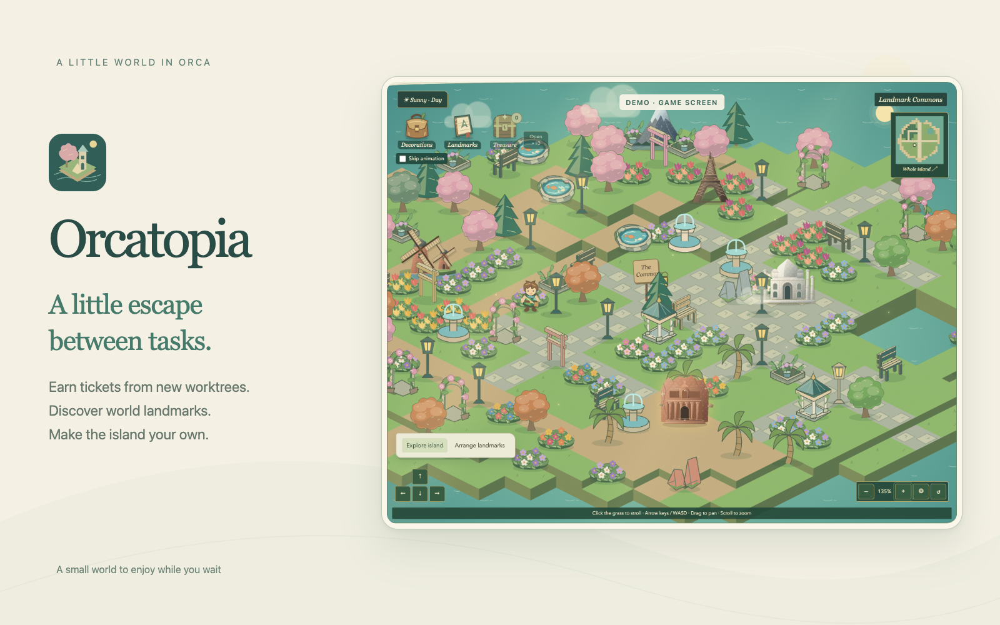

# Orcatopia

English · [한국어](README.ko.md)



Orcatopia is a little island getaway between tasks in Orca. Earn exploration tickets when you create worktrees, discover world landmarks, and arrange a place of your own while you wait. This is an unpublished prototype requiring Orca 1.4.248+.

## Play

While a landmark detail, backup or discovery dialog is open, only the dialog scrolls. Wheel scrolling at its edges or over the backdrop does not move the underlying page. Closing the dialog restores normal page scrolling at the previous position.

Open the Orcatopia panel. In **Explore island**, click grass to walk around buildings, or focus the island and use Arrow keys / WASD. On-screen direction buttons also work. The camera follows the explorer. Drag to pan freely; hover over the map and scroll to zoom at the pointer (12–180%), without clicking, focusing, or holding a modifier key. Scrolling outside the map still scrolls the page. Wheel zoom switches to the free camera without taking keyboard focus. After panning, zooming or viewing the whole island, the next valid walk automatically resumes following at the current zoom and keeps the explorer centered. An unavailable destination leaves the camera alone; **Follow explorer** also recenters without walking. The + / − buttons and two-finger pinch also work. **Whole island** on the minimap fits the island into view; **Follow explorer** recenters on the character. Reset camera restores 100% zoom and following.

The island has illustrated canvas menus: a satchel for **Decorations**, a book for **Landmarks**, and a **Treasure** chest with the remaining ticket count. The two inventories start closed; opening one shows its collection inside the canvas instead of below the island. The list scrolls independently, with no map zoom or page scroll at its edges. Switch menus without losing their scroll positions. Close with ×, the same menu or Escape while focused inside the inventory. Choosing a piece closes the inventory and focuses the island for placement. Crafting keeps it open. The World Map links back to the island journal. The open menu and scroll positions are session-only. A larger responsive canvas and collapsed decoration help leave more room for the island and collection.

The inventory finder stays above the scrolling list. Search landmark or decoration names, countries and regions in English or Korean, regardless of the current UI language. Combine search with **Owned items**, **Ready to place**, rarity filters or **Tiles / Plants / Furniture & structures / Water features**. Decoration searches starting from All unlocked sets switch to All garden sets so matching locked items can also be found; placement and crafting still require their usual unlocks and quantities. Results update without rerendering the map or search input. Each inventory remembers its own search and filters while the panel stays open, including after closing and reopening the list. **Clear search** clears only the text; **Reset filters** restores that inventory’s defaults. These preferences do not modify the save and reset when the panel reloads.

**Arrange landmarks** switches to editing. Selecting a collection card also enters this mode. Select an owned landmark and an empty cell to place it. Select a placed landmark to open its action menu. Choose **Move**, then click an empty destination as prompted; selecting a piece alone does not move it. **Cancel move** keeps it in its original cell. Choose **Return to collection** to remove it. Copies use owned quantities. **World Map** shows real geographic locations and unique country totals, regardless of island placements. Refresh reads the save without awarding anything.

The island canvas contains the mode switch and arrangement desk. Choose **Arrange landmarks**, or select an owned piece from the satchel or journal, to see placement guidance, object/floor layers, rotation, brush, cancel, return and layout undo controls inside the canvas. **Done arranging** returns to exploration and clears the active selection; each edit is saved when performed. Opening an inventory temporarily hides the desk so the two panels do not overlap.

There are 100 landmarks across 97 catalog countries: 56 Discovery, 32 Treasure, 9 Marvel and 3 Wonder. A country can have more than one landmark. Each draw first chooses a tier with 70/23/6/1 percent probabilities, then uniformly selects a landmark in that tier. Owned items always remain eligible; duplicates increase quantity. Tickets are earned only through worktree creation; there is no purchase, pity, or completion guarantee. Original architectural vector illustrations are bundled locally. Each landmark has material shading and fine surface detail: stone courses and weathering, iron latticework, marble domes, copper patina, roof tiles, or mountain strata. Collection and field-guide artwork is larger to expose those details. This is textured illustration, not photography or a surveyed architectural model. The same artwork appears on the island and in the discovery sequence; Wonder animation and reduced-motion support remain available.

Only `workspace.created` with `kind: worktree` earns one ticket. It does not draw a landmark automatically. Folder creation, chats, refreshes, workspace switching and app launch do not earn tickets. Click the **Treasure** chest to open a canvas menu showing your ticket balance, **Open 1**, **Open 10**, and **Skip animation**. Opening the menu spends nothing and works with zero tickets. Choose **Open 1** to redeem one ticket (accessible action: **Open 1 treasure**); unavailable draw sizes are disabled. Close with ×, Escape, the chest again, or a click outside. Opening another collection menu closes this one. A failed draw reopens the menu with a retry for the same ticket. Unused tickets accumulate and survive restarts and worktree removal.

Choose **Open 10** inside the Treasure menu to use exactly 10 tickets in one action. It is available with at least 10 unused tickets. All 10 rewards are saved in one write before presentation; **Retry ×10** recovers the same ticket IDs after a failed or lost response. Draw probabilities and duplicate rewards are identical to single draws; there is no guaranteed high-tier result.

**Newly discovered landmarks of every tier** play the discovery sequence, for both single and ten-ticket draws. Check **Skip animation** inside the Treasure menu to go straight to results for either draw size; uncheck it to restore new-discovery animations. It starts unchecked and is retained across draws, use of the Refresh button and inventory changes while this panel is open; reopening the panel resets it. Duplicates go straight to their results. If a batch contains repeated copies of a new landmark, only its first receipt counts as new. Batch highlights play one at a time; **View all 10 results** or Escape skips to the complete result grid. The grid shows every reward, new/duplicate status, country, tier, gifts/materials and placement actions. Closing or skipping never spends another ticket. Reduced motion skips the sequence timing. The standalone preview still offers all four tier animations.

Choosing a draw size closes the menu and shows its result inside the island canvas. Closing the result returns keyboard focus to the chest. Worker change notifications wait until the result closes before refreshing the canvas, including tickets earned during the sequence. The canvas scrolls into view, and the sequence stays within its visible bounds, including after resizing. Its list/result scroll is separate from map zoom and page scrolling; background controls are unavailable until the result closes. The separate animation preview keeps its standalone presentation. A sealed invitation opens into an illustrated atlas. The camera approaches as a shared pale light travels with a trailing streak. Near its destination, the light reveals the rarity: Treasure turns blue, Marvel opens violet rings and parts the mist, and Wonder briefly slows before golden and iridescent rings expand. A single light wash transitions to the large landmark, followed by its name/rarity and then the action buttons. Discovery / Treasure / Marvel / Wonder sequences take 4 / 4.3 / 4.6 / 5.1 seconds. The final Wonder miniature levitates with orbiting stones. These timing and color cues draw on the supplied [gacha animation reference](https://youtube.com/shorts/GlzSNKIY_LE); all artwork and effects are original bundled SVG/CSS. **Skip animation** or Escape reveals the saved result immediately; reduced-motion preferences show it without waiting. The result shows country, rarity and owned quantity, with **Place on island** and **Keep exploring** actions. Escape closes the result.

The worker serializes ticket earning, draws and placements. Ticket identity is the workspace ID. A draw saves its result and ticket consumption together before animation; retrying the same ticket returns the existing reward, including after a lost response or worker restart. A failed storage write does not consume a ticket unless storage actually committed; retry safely recovers that outcome. Reloading during animation keeps the reward in the collection. UI animation never determines randomness. No event paths are accessed and no Git operations occur.

New discoveries carry a gold star badge and **Place on island**. Previously discovered landmarks carry a check-mark badge labeled **Already discovered** and **Place another copy**. Both can be placed; duplicates remain additional owned copies and award 3 materials. The ten-result list shows the owned count after each reward, and marks only the first occurrence of a new landmark as new.

After a single draw or the ten-result summary, **Draw 1 more** and **Draw 10 more** start another draw directly. The result shows remaining tickets; each button is disabled below its cost of 1 or 10 tickets. Repeat draws respect the current animation preference and use the same saved, retry-safe ticket flow. Batch highlight screens lead to the summary before offering another draw; the standalone animation preview does not spend tickets.

Schema v1/v2/v3/v4 saves are validated and read as v5. Landmark facings default to the original illustration. Existing grass/path decorations move to a separate floor layer at the same cells; other pieces retain their positions and start at their original direction. V1 receipts become already-redeemed tickets, preserving inventory and worktree deduplication without extra tickets. Existing landmark placements retain their exact cell IDs, with enough land kept open to contain them. Gifts and duplicate materials are derived from the complete existing collection, so older discoveries receive these benefits too, without a separate claim or repeat grant. The next successful mutation writes v5 under the existing key (`island-v1`, or `landmark-island-demo-v1` in the demo). Reads do not rewrite saves. Older builds cannot read v5 saves.

The 208-decoration catalog includes four focal garden pieces: **Moonlit koi pond** (Mount Fuji, 9 materials), **Marble garden pavilion** (Taj Mahal, 12), **Rose-covered archway** (Eiffel Tower, 9), and **Fern sanctuary** (Angkor Wat, 6). Own the corresponding landmark to unlock its workshop theme, then craft the piece from duplicate materials. Each occupies one cell, blocks walking, and can be moved or returned to inventory. These pieces have fixed orientation and static original vector artwork. Their crafting and placement records are included in file backups; builds predating these items cannot restore backups containing them.

Placement edits preserve the live island, camera and ambient animation elements. Only changed floors and objects are replaced; unchanged landmarks continue their animations. Editing keeps the current camera framing even if an obstacle requires the explorer to move to another free tile. Returning to exploration resumes camera following. Saves and menu changes do not restart the automatic weather countdown.

## Language

The plugin follows Orca's public `orca.locale` setting. Korean and English are supported; missing, malformed or other languages fall back to English. The plugin checks for changes every 500 ms and when the frame regains focus or visibility because the installed host API documents no locale-change event.

Language changes update text in place, preserving camera position, selection, open dialogs, backup confirmation and running reveal timers. Orca may independently reload a frame. Menus, accessible labels, weather, rarity, quantities, decoration names, landmark descriptions and sources, map country names, known errors and backup dates are localized. Brand names, URLs, filenames and unknown host error details remain unchanged. The operating system controls the language of native file dialogs.

Translations live in `src/messages.ko.json` and `src/landmarks.ko.json`. Save identifiers, receipts, draw probabilities and the save format are unchanged. Standalone browser previews use the browser language; `?lang=ko` or `?lang=en` overrides it, including `?preview=reveal&lang=ko`. A hosted frame always follows Orca, ignoring this preview override.

## Rarity and collection progress

Each landmark has a fixed rarity: **I Discovery** (56 landmarks, 70% tier chance), **II Treasure** (32, 23%), **III Marvel** (9, 6%) or **IV Wonder** (3, 1%). Each badge has a Roman numeral and a four-slot scale: one filled mark is the lowest rarity, four is the highest. The same scale appears on cards, filters, field-guide pages and acquisition notices, with accessible labels such as “Wonder, rarity 4 of 4”. Color is an additional cue; unowned entries keep their full rarity scale. These are fixed ranks, not upgrade progress. The latest acquisition notice and field-guide page show the tier; the field guide explains its draw probability. These are tier probabilities, not the probability of each individual item: items within a tier remain equally likely.

The collection has All / Discovery / Treasure / Marvel / Wonder filters and a progress bar. Counts track unique discoveries, so duplicates increase owned quantities without advancing completion. Filters only change the visible collection entries and do not alter island mode, camera, placements or draw odds. Unowned entries retain their rarity badge and remain readable. Internal tier IDs remain `common`, `rare`, `epic` and `legendary`. The 2026-11-07 allocation changes tier assignments while preserving tier probabilities and saved quantities; no pity or guaranteed completion has been added.

Owned Treasures gain a blue sheen and Marvels a violet halo. The Wonders, Petra, Angkor Wat and Machu Picchu, have gold frames and living miniatures: the structures levitate above grounded shadows while small stones and lights orbit them. This animation appears in the collection, its detail page and island placements. Unowned Wonders stay still. Reduced-motion preferences replace motion with a static floating pose and light effects. These are fictional visual effects; they do not change movement, placement, ownership or probabilities.

## Rarity allocation update (2026-11-07)

The 2026-11-07 allocation used 18 Discovery, 10 Treasure, 5 Marvel and 3 Wonder entries. The later expansion adds entries without changing these existing tiers. This is an editorial game allocation; internal scores and selection criteria are not displayed. Tier chances remain 70/23/6/1%. New additions do not automatically rerank the existing catalog.

Previously owned copies show their updated badge and effects, including after backup restore. Item IDs, quantities, receipts, placements, decoration gifts, crafting materials and unlocked land are preserved. There is no reroll or compensation grant. Petra, Angkor Wat and Machu Picchu gain Wonder motion; Giza and the Great Wall use Marvel effects, and Kilimanjaro uses Discovery styling. Reduced-motion preferences apply to all new Wonders. The following table and expansion tables show the current assignments.

| Rank        | Landmarks                                                                                                                                                                                                                                                                                   |
| ----------- | ------------------------------------------------------------------------------------------------------------------------------------------------------------------------------------------------------------------------------------------------------------------------------------------- |
| I Discovery | Statue of Liberty, Mount Fuji, Gyeongbokgung Palace, Merlion, Brandenburg Gate, Belém Tower, Christ the Redeemer, Great Zimbabwe, CN Tower, Kinderdijk Windmills, Hallgrímskirkja, Atomium, Petronas Twin Towers, Shwedagon Pagoda, Ait-Ben-Haddou, Sigiriya, Sossusvlei, Mount Kilimanjaro |
| II Treasure | Eiffel Tower, Stonehenge, Sydney Opera House, Chichén Itzá, Burj Khalifa, Hagia Sophia, Borobudur Temple, Moai of Rapa Nui, Acropolis of Athens, Saint Basil’s Cathedral                                                                                                                    |
| III Marvel  | Colosseum, Taj Mahal, Great Pyramid of Giza, Sagrada Família, Great Wall of China                                                                                                                                                                                                           |
| IV Wonder   | Petra, Angkor Wat, Machu Picchu                                                                                                                                                                                                                                                             |

## Landmark field guide

Every collection entry shows its country separately from rarity. **About this landmark** opens a field-guide page with the country, region, a short historical description and an official reference link. All 100 entries can be read before acquisition, even if no copies are available to place. Click a placed building in either mode to open its action menu; choose **About this landmark** to read its story. Reading never awards an item or changes a placement. Close with the × button or Escape; keyboard focus returns to the opener.

Descriptions are original English summaries checked against UNESCO, the Eiffel Tower operator, Rome tourism, APSARA and Egypt’s Ministry of Tourism and Antiquities on 2026-11-05. The additional 12 descriptions were checked on 2026-11-06 against UNESCO and the linked official heritage, tourism and monument sites; English and Korean summaries are bundled. Reference URLs are stored separately from the existing Wikidata coordinate sources. Text is bundled for offline reading. In a plugin frame, clicking a reference calls the public `orca.shell.openExternal` API so Orca handles routing and consent; no external link opens on load. Browser demos use ordinary links. An unavailable host link shows an inline message.

## Expanded collection

The first expansion on 2026-11-06 added these twelve entries, bringing the catalog to 24. Rarity is a game collection rank, not an official heritage classification or a judgment of cultural value.

| Landmark             | Country              | Rarity      |
| -------------------- | -------------------- | ----------- |
| Gyeongbokgung Palace | South Korea          | I Discovery |
| Merlion              | Singapore            | I Discovery |
| Brandenburg Gate     | Germany              | I Discovery |
| Belém Tower          | Portugal             | I Discovery |
| Christ the Redeemer  | Brazil               | I Discovery |
| Burj Khalifa         | United Arab Emirates | II Treasure |
| Hagia Sophia         | Türkiye              | II Treasure |
| Borobudur Temple     | Indonesia            | II Treasure |
| Great Zimbabwe       | Zimbabwe             | I Discovery |
| Sagrada Família      | Spain                | III Marvel  |
| Moai of Rapa Nui     | Chile                | II Treasure |
| Great Wall of China  | China                | III Marvel  |

The second expansion adds twelve more entries, bringing the catalog to 36:

| Landmark                | Country     | Rarity      |
| ----------------------- | ----------- | ----------- |
| CN Tower                | Canada      | I Discovery |
| Kinderdijk Windmills    | Netherlands | I Discovery |
| Hallgrímskirkja         | Iceland     | I Discovery |
| Atomium                 | Belgium     | I Discovery |
| Petronas Twin Towers    | Malaysia    | I Discovery |
| Shwedagon Pagoda        | Myanmar     | I Discovery |
| Acropolis of Athens     | Greece      | II Treasure |
| Saint Basil’s Cathedral | Russia      | II Treasure |
| Ait-Ben-Haddou          | Morocco     | I Discovery |
| Sigiriya                | Sri Lanka   | I Discovery |
| Sossusvlei              | Namibia     | I Discovery |
| Mount Kilimanjaro       | Tanzania    | I Discovery |

Tier chances remain 70/23/6/1%; the current allocation contains 56/32/9/3 entries. Per-item chances are approximately 1.25% / 0.71875% / 0.6667% / 0.3333%, respectively. Existing receipts, placement addresses, gifts and unlocked land are preserved; reads do not grant new entries. They enter the normal ticket draw pool. Collection progress now uses 100 as its denominator, so an existing percentage can decrease without losing any items. Backups containing newly introduced landmark or decoration IDs require a build that includes those IDs; earlier catalog builds cannot read them. Save schema and storage keys are unchanged.

Each new entry has its own bundled textured SVG, English/Korean description, official source link, map point and two-piece garden set. Descriptions are original summaries of the linked official heritage, tourism and monument sources. Rapa Nui, the Great Wall, the windmill network and natural landscapes use representative map points, not exact boundaries. Shwedagon’s reference is Myanmar’s submission to UNESCO’s Tentative Lists, not a World Heritage inscription. Wonder effects now follow the current catalog tier. Mount Kilimanjaro is a Discovery and uses its static base illustration. No external images, fonts or runtime requests were added.

## Third catalog expansion (2026-11-08)

Twelve more destinations bring the collection to 48. Existing landmark tiers and tier chances stay unchanged; the resulting distribution is 24 Discovery, 14 Treasure, 7 Marvel and 3 Wonder. The new entries use the normal ticket draw and do not add free rewards to an existing save.

| Landmark                      | Catalog country | Rarity      |
| ----------------------------- | --------------- | ----------- |
| Prague Astronomical Clock     | Czechia         | I Discovery |
| Hungarian Parliament Building | Hungary         | II Treasure |
| Schönbrunn Palace             | Austria         | I Discovery |
| Matterhorn                    | Switzerland     | II Treasure |
| The Little Mermaid            | Denmark         | I Discovery |
| Borgund Stave Church          | Norway          | I Discovery |
| Helsinki Cathedral            | Finland         | I Discovery |
| Obelisk of Buenos Aires       | Argentina       | I Discovery |
| Walls of Dubrovnik            | Croatia         | II Treasure |
| Boudhanath Stupa              | Nepal           | II Treasure |
| Ha Long Bay                   | Vietnam         | III Marvel  |
| Hegra                         | Saudi Arabia    | III Marvel  |

Each entry includes an original textured SVG, two localized descriptions, a reference link, a map point and a pair of garden decorations. The country label is a collection grouping: Matterhorn is grouped under Switzerland, and its description also identifies the Italian border. Large landscapes use representative points. That wave retained the former 318-tile cap and save format. Backups with these new IDs require this catalog or a later compatible build.

## Modern architecture expansion (2026-11-08)

Three modern landmarks extend the catalog to 51 entries across 48 countries. Lotte World Tower (South Korea) is Discovery; Marina Bay Sands (Singapore) and Guggenheim Museum Bilbao (Spain) are Treasure. Their original illustrations use glass facades, a planted rooftop deck and curved titanium surfaces within the island’s storybook palette. Each has English/Korean descriptions, official references, map coordinates and two garden decorations.

These join existing landmarks from the same countries. Owning both increases that country’s collection to 2/2 while the unique-country counter still counts it once. Each distinct landmark independently grants its first decoration and counts toward land expansion, toward the growing island. Duplicate copies retain the existing material reward. Earlier discoveries, placements and tiers are unchanged; new items enter the regular ticket draw, with no automatic grant. Backups containing these IDs need this catalog or a newer compatible build.

## Modern landmarks in eight new countries (2026-11-08)

The preceding wave expanded the catalog to 59 landmarks across 56 countries. That wave added National Museum of Qatar (Qatar), Heydar Aliyev Centre (Azerbaijan), Baiterek Tower (Kazakhstan), National Parliament House (Bangladesh), Kigali Convention Centre (Rwanda), Black Star Gate (Ghana), Biomuseo (Panama) and Casapueblo (Uruguay). All eight countries are new to the catalog. Modern here includes twentieth- and twenty-first-century architecture, including Casapueblo's gradual construction, rather than only recent skyscrapers.

National Museum of Qatar, Heydar Aliyev Centre and National Parliament House are Treasure; the other five are Discovery. These are editorial collection ranks, not official heritage grades. Earlier catalog records and ranks stay unchanged. Each entry includes original vector artwork, bilingual descriptions, an institutional source, a Wikidata map point and two garden decorations. Black Star Gate is kept distinct from Accra's nearby Independence Arch. The new items join normal ticket draws; existing collections receive no automatic grants. That wave retained the save format, former 318-tile cap and tier probabilities. Backups containing these IDs require this catalog or a later compatible build.

## Eight more destinations

This wave adds **Taipei 101** (Taiwan), **Registan Square** (Uzbekistan) and **Sultan Qaboos Grand Mosque** (Oman) as Treasure, plus **Kuwait Towers** (Kuwait), **Bahrain World Trade Center** (Bahrain), **Sky Tower** (New Zealand), **Pyramid of Tirana** (Albania) and **Palace of Parliament** (Romania) as Discovery. These eight country groupings are new to the collection. Each description links to its source in the field guide.

Each includes an original textured illustration, English/Korean descriptions, a map point and two garden pieces. New items join normal single and ten-ticket draws; no rewards are automatically granted. That wave retained existing items, placements, the former 318-tile cap and tier odds. New IDs require this catalog or a newer compatible build when restoring a backup.

## 100 landmarks and larger gardens

The latest expansion adds 33 real destinations from 33 additional country groupings, including Lalibela, Djenné, Rila Monastery, Paro Taktsang, Wat Arun, Tikal and Nan Madol. The catalog now contains **100 landmarks across 97 countries**, with **56 Discovery / 32 Treasure / 9 Marvel / 3 Wonder**. Existing entries keep their tiers. These are game collection ranks, not official heritage grades. Each addition has English/Korean descriptions, an institutional reference, a verified map point, original textured vector artwork and two garden pieces. Sources are available in each field-guide entry.

The island now supports **1,044 usable land tiles** inside a 40 × 40 address grid; the remaining addresses are water. The first 576 addresses and original 318 land tiles keep their identities, terrain and unlock stages. New addresses are appended, so existing placements stay in place. Saves with more than 12 distinct landmarks gain the corresponding outer gardens when opened; no landmark, ticket or crafting reward is granted by loading. The current schema is version 5, including landmark facing. Backups containing new IDs or outer addresses require this build or a later compatible build.

## Garden workshop and growing land

Flower decorations use low beds of small blossoms and foliage. Tulip, meadow, coastal and tropical sets have distinct flower colors; tulips also have cup-shaped petals. Garden trees have layered canopy shading, with slender Roman cypresses and tiered palace/mountain pines alongside rounded canopies; terrain draws cliff faces only along exposed coastlines and height changes. These are bundled vector illustrations.

New islands start with the central 36 land tiles. Each **different landmark owned** opens another connected portion of the coast: 0/1/2/4/8/12 unique landmarks give 36/59/83/130/224/318 tiles. Duplicates, ticket earning and placing/removing pieces do not expand land. The island heading shows the current area and the next collection threshold; the minimap and Whole island camera show the unlocked area. Locked land cannot be walked on or built on, with worker validation as well as UI filtering. Ownership, not the number currently placed, controls growth. There is no expansion purchase. The first 12 discoveries retain the original 318-tile progression. Discoveries 13–100 open connected outer gardens, reaching 425/631/837/1,044 tiles at 25/50/75/100 distinct landmarks. The maximum land area is approximately 3.3 times the former cap.

The canvas satchel’s **Decorations** menu opens a garden workshop with **Soft grass**, **Earth path**, **Stone paving** and **Garden oak** for unlimited free placement. Each of the 100 landmarks unlocks a themed pair of decorations (200 themed pieces, four free basics and four focal pieces: 208 total): its first item is gifted once, and further copies cost 3 materials; the second costs 6 materials. Each duplicate landmark gives 3 materials while retaining the landmark copy. For example, the Eiffel Tower unlocks a Paris lantern and café bench; Giza unlocks an oasis palm and fountain. These are fictional garden interpretations, not historical reconstructions. Select a garden set to preview its locked pieces. All unlocked sets is the default filter.

Choose **Craft** to make the exact piece shown, then **Place** and an empty unlocked cell. Select a placed decoration in Arrange landmarks, choose **Move**, then click its destination, or choose **Return to collection**. Moving and returning are free; return keeps the owned decoration available and does not refund materials. Grass, paths and flowers are walkable; other decorations block movement. Placed decorations replace fixed scenery visually and for collision until returned. Each cell supports one floor and one landmark or decoration above it. Materials cannot buy tickets or landmarks. There are no timers, daily tasks, uploads or payments.

Craft requests are serialized by the worker. A durable request ID makes retries safe after a lost response or restart; **Retry craft** recovers the same piece without paying again. Ownership and available materials come from acquisition and crafting ledgers, not editable UI counters. Backups include the crafting ledger, decoration placements and preserved land boundary along with the existing collection.

Original cell IDs 0–35 keep their identity and relative 6 × 6 layout at the center (columns/rows 9–14). All surrounding cell IDs stay stable as land opens. Migrating an old save preserves any outer placements by keeping their required expansion stage open. If that stage exceeds the current unique collection count, growth resumes once the collection passes it. Moving or removing those old placements does not shrink the preserved area. No user placements are relocated or deleted. Movement and camera state remain session-only.

## Select, then move

Click a placed landmark or decoration to open an action menu beside it, in Explore island or Arrange landmarks. The selected piece is highlighted. Choosing **Move** enters arrangement mode while retaining that exact piece; click an empty unlocked cell to finish. Occupied destinations keep the selection and show an explanation. A completed move returns to the mode used before selecting the piece. Escape or **Cancel move** leaves the piece in its original cell and returns to its menu; closing the selection changes no save data. Menu placement follows camera changes and stays within the canvas. Floors use the same selection menu when editing the floor layer. Rotation, movement and undo preserve the collection and the floor underneath.

## Layered editing, brushes and undo

In **Arrange landmarks**, click an exposed floor to select it directly, or select an object and choose **Select floor beneath**. **Floor** also selects the ground covering beneath objects. Choose **Move**, then click a destination without flooring; selecting alone does not move the tile. A destination may have an object above it. Cancel, return and undo affect only the floor; **Objects** selects the landmark or decoration above it. Selecting a floor from the workshop switches to its layer automatically. Grass, earth paths and stone paving cover the whole tile, replace fixed vegetation and can be painted underneath existing landmarks or decorations. Moving or returning an object leaves its floor in place; changing/removing a floor leaves its object in place.

Select grass, a path or flowers and turn **Brush · On**. Drag over the island to preview a continuous stroke, then release to save all highlighted cells together. Unchanged floors are skipped; flowers skip occupied object cells and stop at the remaining owned quantity. Painting never crafts or spends materials. Escape, pointer cancellation, losing focus or leaving the page cancels an unfinished stroke. Alt-drag pans while a brush is selected; normal drag pans when the brush is off. Wheel zoom remains available between strokes. A single click with the brush off still places one piece. **Cancel selection** leaves placement mode without changing the island.

Benches and garden gates support **Rotate left** and **Rotate right**, stepping backward or forward through four 90-degree directions, either before placement or after selecting a placed piece on the Objects layer. Their upright vector geometry is redrawn for each view. Landmarks support two facing directions using a horizontal mirror of their bundled illustration; both rotation buttons toggle between these two views, not a 3D camera rotation. Other decorations keep their original orientation and show disabled rotation controls with an explanation. Occupied move destinations show a prompt to choose another tile without changing the selected piece. Directions survive moves, reloads and file backups.

**Undo layout** reverts up to 20 layout edits from the current panel session: placement, movement, return, rotation or one complete brush stroke. It restores only floors and object placements. Tickets, discoveries, island growth, crafted inventory and materials are kept. Closing/reloading the panel clears this local undo history, while the resulting layout remains saved. Restoring a backup or receiving a different layout from another panel clears the history. The worker rechecks the current layout and ownership before an undo; stale edits cannot overwrite another layout. There is no redo, terrain sculpting, pond creation or free rotation of landmarks in this update.

## A living island

The woodland-adventure presentation keeps a paper-textured journal and uses deeper forest colors, a green-tunic explorer with a travel pack, mossy stones, and paving stones. Highland rock obstacles appear as weathered rune stones; their collision and placement rules are unchanged. Sunbeams, drifting motes and a trail lantern add ambient light, with weather/time-of-day variants and reduced-motion support. These are decorative scenery, not quests or collectible rewards. The collection is laid out as a field guide. All artwork and texture patterns are bundled vector/CSS assets; no fonts or images are fetched at runtime. Panel backgrounds, reading text, controls, selected states, keyboard focus, input borders and dialog chrome use the documented `--orca-*` theme tokens, including their paired foreground colors and radius. Theme changes apply in place without resetting the camera or collection. Without host tokens, the browser demo keeps paper/dusk fallback palettes. Island terrain, landmark art and rarity effects keep their own game palette; the reveal stage is artwork inside a themed dialog. The root rem base remains 16px.

The fixed isometric world has a central landmark commons, woods, meadows, a lagoon and graded highland terraces. Tiles have visible side faces; the explorer, buildings and trees render in depth order so they can pass in front of or behind one another. The scene includes flowers, a sandy shoreline, drifting clouds and a bobbing boat. This is a local 2.5D vector scene, not a 3D physics engine. **Weather** offers Sunny, Cloudy, Rain and Snow. Auto cycles fictional weather every 30 seconds while the panel is visible. **Time of day** defaults to **Auto · device time**, following the device’s local timezone: Dawn 05:00–07:00, Day 07:00–17:00, Sunset 17:00–19:00 and Night 19:00–05:00. Lighting, the sun/moon, stars and garden lanterns follow that phase. These are fixed artistic time bands, not calculated sunrise/sunset times. The next boundary is scheduled locally; returning from sleep, refocusing the panel or reopening the island rechecks the device clock. Choose a manual time to hold that atmosphere, or return to Auto to sync immediately. Weather and daylight are independent; neither changes rewards or saved inventory. Manual choices last for the panel session; reloading restores device time. Daylight uses no location permission. The separate timezone weather mode below reads external forecast data.

Walking, camera and manual climate choices are session-only visual state: reopening/reloading resets them, while inventory and landmark layout remain saved. The timezone weather cache persists separately. Walking never awards items or changes placements. Buildings block routes; a completely filled island has no walking space until an obstacle is returned. Trees and rocks block walking; flowers are passable. Placing a landmark on vegetation replaces that decoration visually; removing it restores the vegetation. Pan/zoom is limited and can be reset. Background panels pause climate advancement. Reduced-motion preferences disable ambient animation and movement transitions. There is no sound.

## Timezone weather

The Orca panel defaults to **Timezone weather**. The device timezone selects a reference location: `Asia/Seoul` → Seoul, `Asia/Tokyo` → Tokyo, `America/Los_Angeles` → Los Angeles. This is the reference location's weather, not the user's precise location. No GPS, IP geolocation or city search is used. The bundled public-domain [IANA timezone database](https://www.iana.org/time-zones) 2026f `zone.tab` supplies 418 principal-location coordinates; 131 additional aliases from `tzdata.zi` are resolved without replacing country-specific rows. UTC and unmapped zones use labelled simulated weather.

The worker requests the current weather code from `https://api.open-meteo.com/v1/forecast`, caching results for one hour per reference location in `weather-v1:<zone>`. This is separate from collection data and exported backups. Concurrent requests are combined, and the cache survives worker restarts. While the island view is visible, the next refresh is scheduled at expiry. Hidden pages, the World Map and manual/fictional weather modes do not initiate refreshes. Reopening or returning to the foreground reuses fresh reports and updates expired ones. Timezone changes are checked on focus/resume and during the scene's existing 30-second weather tick. In-flight requests may finish while hidden; late replies for a previous timezone never change the current scene.

A failed update retains the last weather and its original update time, with a visible failure note. Without an earlier report it uses labelled simulated weather. Failed attempts also wait one hour before retrying, including after worker restart. Weather updates preserve the island nodes, camera, daylight and collection. Only reference coordinates and query parameters are sent, plus normal connection metadata such as the worker host's IP address. No repository paths, collection records or activity logs are transmitted. Source links open only when clicked through Orca's external-link API.

Clear/mainly clear codes map to Sunny; clouds/fog to Cloudy; drizzle/rain/showers/thunderstorms to Rain; snow/snow showers to Snow. This is an artistic simplification of model-based weather, not an exact real-time observation. Data: [Open-Meteo](https://open-meteo.com/en/docs), adapted under [CC BY 4.0](https://creativecommons.org/licenses/by/4.0/). The API is subject to the provider’s [service terms](https://open-meteo.com/en/terms). No API key is bundled. See the bundled [weather data notice](licenses/weather.txt).

**Auto · island forecast** retains the fictional 30-second cycle, alongside manual Sunny/Cloudy/Rain/Snow options. Mode choices last for the panel session. The standalone browser demo defaults to fictional weather, never contacts the provider and explicitly labels its Timezone weather option as simulated. UI tests use a mocked Orca bridge. Run `ORCATOPIA_WEATHER_LIVE=1 pnpm nx run landmark-island:test` for the optional direct-worker live API check.

## Local preview and verification

From the repository root:

```sh
pnpm nx run-many -t build typecheck test ui-test -p landmark-island
pnpm nx run landmark-island:preview
pnpm validate
```

Open http://127.0.0.1:43187. The browser is visibly labeled **DEMO**; **Demo worktree** simulates a creation event and earns one ticket. Then open **Treasure** and choose **Open 1**. It uses only `landmark-island-demo-v1` in browser localStorage. Host mode has no manual ticket-grant button and reads/writes only through its own worker. Browser demo storage does not touch the Orca save. UI text is English in this prototype.

The packaged plugin is `dist/plugins/landmark-island`. It needs no runtime downloads. The build validates artifact policy; `pnpm validate` uses Orca's actual manifest validator. Node tests simulate concurrent and repeated events, restart persistence, failed storage, placement limits and worker delivery without panels. Browser tests exercise acquisition, duplicates, island edits, map counts, reloads, narrow layout and light/dark classes. These are fixtures, not live host evidence.

For the standalone animation theatre, open [Reveal Preview](http://127.0.0.1:43187/?preview=reveal&tier=legendary&autoplay=1). It starts with Wonder and offers all four rarity previews and replay. It uses the same reveal renderer, reads/writes no save, and replaces placement actions with replay/rarity selection. This route is browser-demo only; plugin frames continue to use their worker.

## File backups

Open **Backups** in the panel navigation, then **Save backup file**. The dialog prepares a snapshot of unused and spent tickets, acquisition receipts, crafting records, landmark/decoration placements and preserved land. Materials and gifts are reconstructed from those records. In Orca, the Save button calls `orca.files.saveAs` directly from your click; you choose the destination and the plugin never receives its path. In the browser demo it downloads a JSON file containing only the demo save. Reopen Backups to prepare a newer snapshot. Walking, camera and weather are not included. No analytics or uploads are involved.

To restore or move to another computer, choose the JSON backup in **Choose a backup to restore**. The preview shows unused tickets, total/unique landmarks, landmark and decoration placements, materials, land area and export time. Check **I want to replace my current island**, then choose **Replace island**. This replaces the complete save; it does not merge collections. Later progress is discarded, including ticket consumption after the snapshot. This is a personal offline backup, not an anti-cheat or multi-device synchronization system.

The worker validates the file again and checks that the current save still matches the reviewed snapshot. If a new worktree or another action changed it, close Backups and review again. Before replacement, it stores one pre-restore copy under `island-before-restore-v1` (the demo uses `landmark-island-demo-v1-before-restore`). **Review pre-restore copy** uses the same preview and confirmation to recover it. Preparing a different restore replaces that one recovery slot before writing the new island; repeated restoration of the same state does not duplicate rewards or overwrite the slot. If saving the recovery copy fails, the current save is not replaced. A lost response may follow a successful save: refresh and check before retrying.

Files use the `landmark-island-backup` envelope, format version 1, and are limited to 256 KiB. Unknown formats/versions, malformed JSON, duplicate IDs, unowned or invalid placements and rewards without tickets are rejected before writing. State schemas v1/v2/v3/v4 inside a valid envelope migrate to v5 using the rules above, without extra tickets. Import requires a readable current save for comparison; it does not repair an already corrupted local store. Files include workspace identifiers that may contain local paths, plus acquisition times; keep them private. Clearing plugin data also removes the internal recovery copy, so keep an exported file elsewhere.

## Host access and limits

This is a trusted Node worker running with your OS account's access. Its declared capabilities are `workspace:read` and `storage:own`. It does not request Git writes, terminals, agents or notifications. In timezone weather mode the Node worker makes HTTPS requests to the fixed Open-Meteo endpoint; UI frames never fetch weather directly. Authorizing Git Logs does not authorize this identity.

For a local installation, use `orca plugin dev load dist/plugins/landmark-island --json`, review the exact approval fingerprint/access returned by Orca, and authorize execution explicitly. The development plugin was loaded and approved on the verification host with user authorization on 2026-11-06; this does not authorize another installation. See the live verification record below for completed checks and remaining UI checks. Disabled-event replay is not documented: events missed while disabled are not backfilled, and storage failures may lose an event unless it is delivered again. No historical workspace scan runs on launch.

One plugin-local collection is shared across repositories/worktrees on this host. It is an offline save, not a cloud account or backup. Clearing plugin data can lose it. Receipts are retained indefinitely for deduplication, so very large saves will eventually encounter host storage/response limits; archiving receipts is not implemented. Future schemas are refused rather than silently overwritten. Multiple independent worker processes writing the same store are outside the prototype contract; the queue assumes Orca's single worker per plugin. Multiple browser demo tabs are not coordinated.

Map data: [Natural Earth](https://www.naturalearthdata.com/about/terms-of-use/), public domain. Landmark coordinates: Wikidata CC0; entity source links are included in the bundled catalog. See [geography attribution](licenses/geography.txt). Geometry is generalized, and small countries may not appear. Fictional island cells are unrelated to geographic coordinates.

Deferred: terrain beyond the 1,044-tile world, cloud sync, trading, languages beyond Korean/English and collections above 100 landmarks. Nothing is published.

## Verification record (2026-11-05)

- `pnpm nx run landmark-island:typecheck`: passed.
- `pnpm nx run landmark-island:test`: passed ticket/reward atomicity, concurrent deduplication, response-loss recovery, v1 migration without extra tickets, worker draw handling, and the worker/state assertions above, stable original cell addresses, water/boundary rejection, expanded placement persistence, and reachability of all unoccupied land around terrain obstacles.
- `pnpm nx run landmark-island:ui-test --output-style=static`: 19 browser tests passed, including live custom light/dark host token changes, paired control colors, keyboard focus, unchanged camera/art/save, themed dialogs and click-only external-link routing, standalone preview/replay across all tiers without storage access, camera motion, neutral-to-rarity light changes, artwork/information/action ordering, reduced motion enabled during a reveal, ticket accumulation, explicit drawing, failed-save retry, repeated-click protection, animation skipping/reduced motion, reload during reveal, mobile results, direct placement, and live Wonder motion in all three views, unowned/static reduced-motion alternatives, unchanged saves, rarity filters, Wonder/Discovery acquisition badges, all four ordinal scales and accessible rank labels, duplicate-safe collection progress, all 12 country/description pages, unowned reading, modal keyboard/focus/mobile behavior, inspection versus building edits, unfocused pointer-anchored wheel zoom and outside-page scrolling, walking around buildings, depth order, keyboard controls, camera follow/pan/zoom/reset, minimap overview on narrow screens, automatic/manual climate, reduced motion, ownership isolation and persistence of both original and expanded land placements; screenshots inspected under `test-results/landmark-island/`.
- `pnpm nx run git-logs:build --skipNxCache --output-style=static`: passed with the shared builder; Git Logs source is unchanged. Its typecheck passed and its worker/artifact suite passed 49 tests.
- Git Logs UI regression run was attempted but its server timed out: port 4173 is occupied by an older preview in another worktree returning HTTP 404. That process was not stopped or changed.
- `pnpm validate`: both packaged manifests passed the installed Orca validator. `orca plugin inspect dist/plugins/landmark-island --json` reports valid and `needsApproval: true`.
- At this fixture verification checkpoint, no real-host loading or execution approval had been performed. The later live checks are recorded below. No push, merge or publication was performed.

## Live host verification (2026-11-06)

- Loaded `local.landmark-island` from the packaged development folder with explicit user authorization for its trusted worker, `workspace:read` and `storage:own`. Orca reported no reconsent requirement.
- The initial host save was empty. With no panel open, created a disposable `landmark-island-live-check` worktree through Orca: exactly one ticket was saved and no landmark was drawn. Re-delivering that workspace event before and after worker restart did not add tickets. Removing the clean test worktree preserved its ticket.
- Redeemed that ticket through the live worker's `island.draw` request: one Chichén Itzá (Treasure) was saved. Restarting the worker and retrying the same ticket returned the same receipt and timestamp, without an additional draw. The test reward remains in the host collection; browser demo storage was not changed.
- Opened the actual Orca panel. Host captures at 420px and 1000px showed the ticket, themed controls, collection and island. A first narrow capture missed the terrain; a later narrow capture showed the terrain and explorer correctly. Capture results and worker logs reported no errors. This is visual evidence, not proof of interactive behavior at those widths.
- Native click verification is blocked by macOS accessibility: Orca Computer Use reports permission granted but cannot read Orca's window (`permission_denied`); the alternative native app connection also timed out. Actual panel button/reveal interactions, hover-wheel input, source-link routing and live theme switching remain unverified. Orca refused a light capture override while its window was visible, so only the current dark host theme was captured. Browser fixture coverage above does not replace these checks.
- Persistence was checked across worker restarts, not a full Orca application restart. No push, merge or publication was performed.

Nx generator discovery found no Orca-specific generator. The installed Orca `worker-panel` scaffolder failed because its bundled `orca.d.ts` resource was missing. This plugin follows the existing Nx run-command build pattern and narrow API contracts from the installed authoring references.

## Backup verification (2026-11-06)

`pnpm nx run landmark-island:typecheck` and `pnpm nx run landmark-island:test` passed. All 23 tests passed in `pnpm nx run landmark-island:ui-test --output-style=static`. Worker fixtures cover export/import, old schemas, invalid files, changed saves, recovery-write and restore-write failures, response-loss retries across restart, repeated import and recovery. Browser fixtures cover file download, preview/cancel/confirmation, restart persistence, recovery, narrow light/dark dialogs, invalid/oversized files, stale previews and the gesture-bound host Save API with cancellation/errors. The live Orca worker also returned a valid backup envelope through the read-only export handler without changing its save. `pnpm validate` passed for both packaged plugins. Native Orca file dialogs and clicks remain deferred at the user's request; live user data was not restored or replaced during these tests.

## Material artwork update (2026-11-06)

Typecheck, all 24 UI tests and packaged manifest validation passed. The material-art refresh is covered by the UI suite, including local SVG paint-reference isolation across collection cards, repeated island copies and detail dialogs. Gallery and close-up captures are saved under `test-results/landmark-island/material-*.png`. No external artwork, fonts or runtime downloads were added.

## Garden and land progression verification (2026-11-06)

`pnpm nx run-many -t typecheck test ui-test -p landmark-island --output-style=static` passed, including its build dependency and all 27 browser tests. Worker fixtures check every expansion stage for connected land, stable old placement addresses, locked cells/sets, retroactive gifts/materials, crafting cost and inventory conservation, concurrent requests, failed writes, lost responses across restart, shared occupancy and v3 backup round trips. Browser fixtures cover 36 → 59 → 83 growth, duplicate-only material rewards, selected crafting, gifted/free decoration placement, movement/return/reload, locked coastline and obstacle walking, retry without a second charge, and narrow light/dark workshop layouts. Captures are under `test-results/landmark-island/garden-*.png` and `growing-island.png`. These are isolated fixtures; no real user save was seeded or restored. Native Orca clicks remain deferred. Git Logs source and capabilities are unchanged; no execution approval, push or publication was performed in this update.

## Editing freedom verification (2026-11-06)

Build, typecheck, worker/state tests and all 30 browser tests passed through Nx. New checks cover v3 floor migration, independent floor/object occupancy, four furniture views and saved directions, layout-only undo with intervening rewards/crafts, stale-layout rejection, whole-stroke validation, insufficient flower inventory, failed storage, cancelled mouse strokes and one-step brush undo. The browser capture `test-results/landmark-island/layered-garden.png` shows an Eiffel Tower on paving and a rotated bench above a separate path. These are browser/worker fixtures. Native Orca clicking remains deferred; no user save was reset, restored or seeded, and no execution approval or publication was performed.

## Canvas inventory verification (2026-11-06)

`pnpm nx run-many -t typecheck ui-test -p landmark-island --output-style=static` passed, including build and all 33 browser tests. After tightening scroll restoration on reopen, the three canvas inventory tests were rerun with `pnpm nx run landmark-island:ui-test --grep='canvas inventor' --output-style=static`. They cover closed-by-default canvas menus, internal and edge scrolling without camera/page movement, independent scroll positions, close/reopen and keyboard focus, selection-to-placement, the World Map journal link, and narrow light/dark layouts with visible artwork. The enlarged canvas and inventories were visually inspected in `test-results/landmark-island/canvas-*.png`. `pnpm validate` passed for both packaged plugins. These are isolated browser fixtures; native Orca clicking remains deferred. No host save, permissions or Git Logs code changed.

## Canvas treasure verification (2026-11-06)

`pnpm nx run-many -t typecheck ui-test -p landmark-island --output-style=static` passed build, typecheck and all 34 browser tests; `pnpm validate` passed both packaged plugins. The browser suite covers the canvas chest, ticket counts, disabled/retry states, reward-before-animation persistence, direct placement, and the reveal staying inside the visible canvas after resizing. It also checks modal scroll isolation, focus return, reduced motion, unchanged standalone previews, and the existing inventory/placement flows. Desktop and narrow captures are saved as `test-results/landmark-island/canvas-treasure-*.png`. Verification uses isolated browser fixtures; native Orca clicking remains deferred. The worker, stored schema and reward probabilities are unchanged.

## Language verification (2026-11-06)

`pnpm nx run-many -t typecheck test ui-test -p landmark-island --output-style=static` passed, including the dependent build and all 40 browser tests. Six language scenarios cover host precedence, live Korean/English changes, unsupported locale fallback, translated discovery/placement/decorations/weather/backup flows, the file chooser button, narrow light/dark layouts and a standalone preview without save access. Assertions preserve camera, focus, journal scroll, backup confirmation, reveal progress and saved identifiers across language changes. Pure translation checks also cover every landmark's descriptive fields, dynamic quantities and localized dates. `pnpm validate` passed for both packaged plugins.

These are isolated browser fixtures, including a mock of the documented `orca.locale` API, not evidence of clicking the live Orca language setting. Native Orca panel clicking remains deferred at the user's request. No capabilities, save schema, plugin identity or Git Logs source changed.

## Camera follow verification (2026-11-06)

`pnpm nx run-many -t typecheck ui-test -p landmark-island --output-style=static` passed, including build and all 42 browser tests. New desktop and narrow reduced-motion scenarios verify that valid keyboard, direction-button and multi-cell click movement resumes tracking after pan, wheel zoom and whole-island overview. They check the rendered explorer stays centered, zoom is preserved, rejected moves leave the free camera alone, and the save is unchanged. `pnpm validate` passed. These are isolated browser fixtures; native Orca panel clicking remains deferred.

## Catalog expansion verification (2026-11-06)

`pnpm nx run-many -t typecheck test ui-test -p landmark-island --output-style=static` passed build, typecheck, state/worker tests and all 43 browser tests. Catalog checks cover every item in each draw pool, unique IDs and countries, all 52 decorations, both languages, a full-catalog backup round trip, crafting retry, and the unchanged 318-tile cap. Browser fixtures draw all 12 new entries, preserve an old Eiffel Tower receipt and placement, unlock gifts, place the Great Wall, verify its animated/static alternatives, map 13 collected countries and switch to Korean. The field-guide test now reads all 24 entries. All artwork is checked for SVG path errors and isolated paint references.

After the final illustration alignment, `pnpm nx run landmark-island:ui-test --grep='material artwork|expanded catalog' --output-style=static` was rerun. The isolated artwork contact sheet `test-results/landmark-island/new-destinations-demo.png` and detail screenshots were visually inspected. These are fixture captures, not live host verification. Native Orca clicks remain deferred; no real user save, Git Logs source, plugin identity or permissions changed.

## Second catalog expansion verification (2026-11-07)

`pnpm nx run-many -t typecheck test ui-test -p landmark-island --output-style=static` passed build, typecheck, state/worker checks and all 44 browser tests. The catalog checks now cover 36 unique landmarks/countries, 76 decorations, every draw-pool member, bilingual descriptions, full-catalog backup and the unchanged land cap. Separate browser scenarios exercise both twelve-entry expansions: acquisition, gift unlocks, old receipts/placements, maps, Korean text and animated/reduced-motion Wonders. The field guide reads all 36 entries. The new twelve-artwork DEMO sheet and enlarged details were visually inspected at `test-results/landmark-island/new-destinations-36-demo.png` and `material-*.png`.

`pnpm validate` passed both plugin artifacts. Verification uses isolated fixtures; native Orca panel clicking remains deferred. Real host saves, plugin identity/capabilities and Git Logs source are unchanged. No plugin execution approval, push or publication was performed.

## Rarity allocation verification (2026-11-07)

The Nx build and typecheck passed, and the full browser suite passed all 46 tests. The initial state-test run exposed a fixture that assumed a zero roll selected Eiffel Tower; after explicitly selecting its new Treasure pool, `pnpm nx run landmark-island:test --output-style=static` passed. The three new Wonders are each checked for unowned static art, owned animation in cards/details/island placements, orbit movement, reduced-motion behavior and unchanged saves.

After adding full-catalog effect assertions, `pnpm nx run landmark-island:ui-test --grep='material artwork|expanded catalog' --output-style=static` passed all three selected tests. Only the three current Wonders contain Wonder artwork. Previously saved Giza placements and the two expansion scenarios remain intact; Great Wall and Kilimanjaro no longer carry Wonder art. SVG references, all draw pools, backup round trips, quantities, materials and land preservation are covered. The new Petra, Angkor Wat and Machu Picchu detail captures were visually inspected. `pnpm validate` passed both plugin artifacts. These are isolated fixtures; native Orca clicks remain deferred, with no real-save changes, plugin execution approval, push or publication.

## Orcatopia 0.1.0 release candidate

The display name is now **Orcatopia**. The internal plugin ID and Nx project remain `landmark-island`. Storage keys, item IDs, draw probabilities and the `landmark-island-backup` format are unchanged; existing backups remain compatible.

This is an unpublished candidate. The planned catalog identity is `tienne.landmark-island`, whereas the development installation uses `local.landmark-island`. These identities do not share storage or execution approval. Before switching, save a backup from the development panel. After installing and explicitly approving the catalog plugin, restore that file through Backups. Keep the original backup and avoid running both identities together, since they receive worktree events independently. Installation does not grant tickets for existing worktrees.

Known release limits: actual Orca clicks and light-theme interaction remain deferred; a full application restart and a fresh catalog install/update have not been verified. Worker restart, duplicate event handling and persisted rewards were verified on the live host. The 2026-11-08 pre-release checkpoint passed all 82 browser scenarios, plus worker/state tests and package validation. Browser fixtures do not establish native host behavior. Events missed while disabled are not backfilled. Saves are local; cloud sync is not included.

## Focal garden pieces verification (2026-11-07)

The catalog contains 80 decorations. Nx typecheck and state/worker tests passed, including landmark ownership, all four new crafting costs, retry after restart, placement quantities and backup round-trips. The 49 existing browser tests passed; the new crafting, placement, reload and Korean-label scenario passed on a targeted rerun after isolating the standalone preview's missing favicon request. All four new workshop illustrations and their island rendering were visually inspected. `pnpm validate` passed for both packaged plugins. No external assets, fonts, permissions or Git Logs changes were added. Native Orca clicking remains deferred.

## Third catalog expansion verification (2026-11-08)

Nx build, typecheck, state/worker tests and all 51 browser tests passed for the 48-entry catalog. Tests cover every draw-pool entry, the 104-decoration catalog, full-collection backup round-trips, new set crafting retries, all descriptions, paint-reference isolation, and acquisition of all twelve new entries while preserving an old collection and its placements. The new wave also checks map countries, land-cap preservation and Korean detail pages. Coordinates were checked against the linked Wikidata records; descriptions use the linked official monument, tourism or heritage sources. All 36 earlier catalog records and their Korean descriptions remain unchanged. Native Orca clicking remains deferred.

The final coordinate and stupa-finial adjustments also passed targeted artwork and new-wave browser checks. `pnpm validate` passed for both packaged plugins. The English DEMO contact sheet is `test-results/landmark-island/new-destinations-48-demo.png`.

## Modern catalog verification (2026-11-08)

Nx build, typecheck and state/worker tests passed for 51 landmarks across 48 countries and 110 decorations. All 51 existing browser scenarios passed. The new shared-country scenario passed after correcting its test-only random setup, and the artwork scenario passed again after clipping Marina Bay Sands window lines to each tower. These checks cover the three new draws, individual gifts, placement persistence, duplicate materials, crafting, Korean descriptions, 2/2 country groups with a stable unique-country count, and SVG paint/clip reference isolation. The existing 48 catalog records are unchanged. The English fixture contact sheet is `test-results/landmark-island/modern-landmarks-51-demo.png`. Native Orca clicking remains deferred.

## Device daylight verification (2026-11-08)

Build, typecheck and state/worker checks passed, together with all 77 browser scenarios. Clock fixtures cover every local phase boundary, the next morning, different device timezones, the daylight-saving fallback, resume/focus resynchronization, manual overrides and unchanged island nodes, camera and saves. Korean narrow-panel night and sunset captures were visually reviewed. Native Orca clicking remains deferred; this update adds no capabilities, execution approval or publication.

## Timezone weather verification (2026-11-08)

Build, typecheck and state/worker checks passed, including durable hourly cache reuse, restart/failure cooldown, concurrent request coalescing, isolated storage, validated weather codes and bounded HTTP responses. The opt-in direct-worker test successfully queried Open-Meteo for the Seoul reference location. The full browser run passed 81 of 82 scenarios; its one failure was an older language test expecting only the collection-read request. After allowing the new weather read, all six language scenarios passed on rerun. Five weather scenarios cover hourly scheduling, hidden/closed views, manual selection, stale/unknown fallback, late timezone replies, localization and source clicks. The narrow Korean weather view was visually inspected. Actual Orca clicking remains deferred; no execution approval, push or publication was performed.
